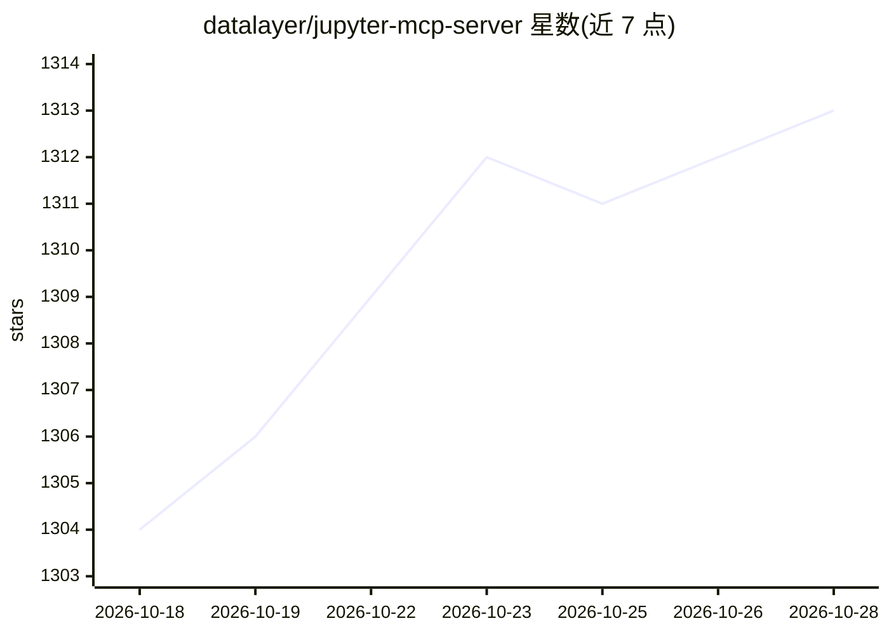

# datalayer/jupyter-mcp-server

⭐ 1,314 · Python · BSD-3-Clause · 推送 2026-10-27 · [GitHub](https://github.com/datalayer/jupyter-mcp-server) · [官网](https://jupyter-mcp-server.datalayer.tech) · 组织维护

**供 AI agent 实时连接与操作 Jupyter Notebook 的 MCP 服务器**

由 Datalayer 开发维护的 Model Context Protocol 服务器，让 MCP 客户端（Claude Desktop、Cursor、VS Code、Windsurf 等）实时读取、编辑与执行 Jupyter Notebook 的单元格，支持多 Notebook 切换、多模态输出与 OpenTelemetry 观测。代码执行默认经 Jupyter Server，也可切换到 Datalayer、Kaggle、Google Colab、E2B 等沙箱后端。提供 pip 安装、uvx 快速启动与 Docker 生产部署，另有 Datalayer 托管端点与 OAuth 2.1 认证，按 scopes 控制各 agent 权限。BSD 3-Clause 许可。

## 筛选速览

| 维度 | 判定 | 备注 |
|---|---|---|
| AI 角色 | `ai-ecosystem` | LLM/agent 周边工具 |
| 许可风险 | `permissive` | BSD-3-Clause |
| 部署形态 | `self-host` | docker 或自建部署 |
| 模型依赖 | — | README 未给出锁定关系 |
| 硬件要求 | — | 无带数字的原话,不猜 |
| 安装摩擦 | `low` | 无编译、无系统依赖或容器化 |
| 成熟度 | — | 结构信号不足 |

## 能力要点

- 实时查看 Notebook 变化，单元格执行失败时依据输出反馈自动调整
- 工具分四组：服务器/沙箱、Notebook、单元格、执行，工具 schema 由运行时快照生成
- 沙箱后端可切换：Jupyter Server（默认）、Datalayer、Kaggle、Google Colab 等
- OAuth 2.1 认证与 scopes 权限分离，可单独断开某个 agent

## 适用场景

- 在 Claude Desktop/Cursor 等 MCP 客户端中直接操作和运行我的 Jupyter Notebook
- 让 agent 在 GPU 代码沙箱（Datalayer/Kaggle/Colab 等）中执行 Notebook 代码
- 为团队 JupyterHub 提供 agent 接入并控制其执行权限

## 场景标签

`Agent 框架` · 领域:Agent 开发

## 证据(README 行号)

> L7: **An MCP server developed for AI to connect and manage Jupyter Notebooks in real-time — and scale your Code Sandbox 
> L133: - 🤝 **MCP-compatible:** Works with any MCP client, such as Claude Desktop, Cursor, Windsurf, and more.
> L151: - **Server and code sandbox** — browse the Jupyter file system, list kernels, connect to

## 星数曲线

2026-10-18 1,304 → 2026-10-28 1,313（+9）

---
*卡片 v1 · prompt 1.4 · 生成 2026-10-21 · 置信度 high · 依据 README sha `1bb434c75623` · [字段定义](../../DATASET.md)*
