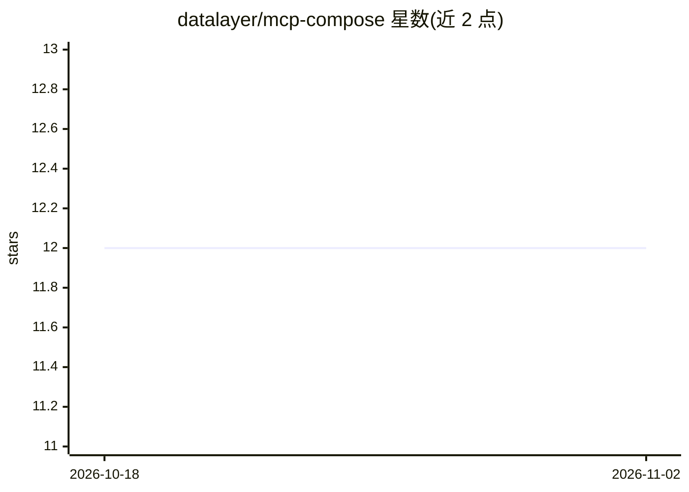

# datalayer/mcp-compose

⭐ 12 · Python · BSD-3-Clause · 推送 2026-10-18 · [GitHub](https://github.com/datalayer/mcp-compose) · [官网](https://mcp-compose.datalayer.tech) · 组织维护

**MCP 服务器编排管理工具：统一启动、监控与组合多个 MCP 服务器**

面向管理多个 Model Context Protocol (MCP) 服务器的编排工具，类比 Docker Compose：以 TOML 配置声明式管理 STDIO/SSE/HTTP/Streamable HTTP 多类 MCP 服务器的启动、停止、重启与自动重启；提供工具自动发现与冲突解决（前缀/后缀/覆盖）、STDIO 与 SSE 协议互译、32 个端点的 REST API、React Web UI、实时指标/日志监控、令牌认证与速率限制。支持 pip 安装、Docker 部署与 Python API 调用，另有 Prometheus/Grafana 资源与 Kubernetes 部署文档。

## 筛选速览

| 维度 | 判定 | 备注 |
|---|---|---|
| AI 角色 | `ai-ecosystem` | LLM/agent 周边工具 |
| 许可风险 | `permissive` | BSD-3-Clause |
| 部署形态 | `self-host` | docker 或自建部署 |
| 模型依赖 | — | README 未给出锁定关系 |
| 硬件要求 | — | 无带数字的原话,不猜 |
| 安装摩擦 | `low` | 无编译、无系统依赖或容器化 |
| 成熟度 | — | 结构信号不足 |

## 能力要点

- TOML 配置编排多类 MCP 服务器（STDIO/SSE/HTTP/Streamable HTTP）
- 工具自动发现、智能组合与命名冲突解决策略
- 32 端点 REST API + React Web UI 实时监控
- STDIO ↔ SSE 协议互译，无需改动既有服务器

## 适用场景

- 一条命令拉起本地多个 MCP 服务器用于 AI 开发环境
- 把多个 MCP 服务器的工具组合成统一接口供 agent 调用
- 团队统一 MCP 服务器的启动、监控与安全管控

## 场景标签

`模型网关` · 领域:Agent 开发

## 证据(README 行号)

> L14: > **Similar to Docker Compose - Orchestrate Model Context Protocol (MCP) servers with management capabilities, REST
> L18: MCP Compose is a comprehensive solution for managing multiple MCP servers in a unified environment. It provides aut
> L92: - Local AI development environments: Spin up multiple MCP servers (tools, data sources, agents) on your laptop with

## 星数曲线

2026-10-18 12 → 2026-11-02 12（+0）

---
*卡片 v1 · prompt 1.4 · 生成 2026-11-01 · 置信度 high · 依据 README sha `2c83d1a3e787` · [字段定义](../../DATASET.md)*
