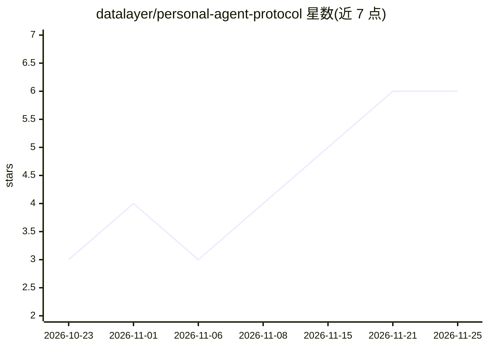

# datalayer/personal-agent-protocol

⭐ 6 · Python · BSD-3-Clause · 推送 2026-11-21 · [GitHub](https://github.com/datalayer/personal-agent-protocol) · [官网](https://personal-agent-protocol.datalayer.tech) · 组织维护

**为个人 agent 接入公司 agent 的 PAP 协议 Python/TypeScript SDK**

实现 Personal Agent Protocol v1.0 与 0.4（含 Operations 扩展 v3）的双语言 SDK：个人 agent 通过读取公司 /.well-known/poppy.json 完成发现，创建会话并为每个请求签名 Session JWT，支持匿名提问、受控登录（PKCE、浏览器交接）与续接授权对话。SDK 基于名为 Reactor 的插件贡献系统组装安全与平台能力（签名、密钥托管、令牌存储等），并自带 pap 命令行工具做配置与公司验证。SDK 不决定 agent 使用哪个模型或说什么。

## 筛选速览

| 维度 | 判定 | 备注 |
|---|---|---|
| AI 角色 | `ai-ecosystem` | LLM/agent 周边工具 |
| 许可风险 | `permissive` | BSD-3-Clause |
| 部署形态 | `library` | 以包/库形式分发 |
| 模型依赖 | — | README 未给出锁定关系 |
| 硬件要求 | — | 无带数字的原话,不猜 |
| 安装摩擦 | `low` | 无编译、无系统依赖或容器化 |
| 成熟度 | — | 结构信号不足 |

## 能力要点

- 实现 PAP v1.0/0.4 与 Operations v3 的完整协议面（发现、会话、对话、登录）
- ES256/PS384 JOSE、委托密钥、Session JWT 签发与重放检查等密码学机制
- 基于 Reactor 插件贡献系统组装平台与安全行为，缺失安全贡献时 fail closed
- 提供 pap CLI 与官方一致性测试报告及独立测试记录

## 适用场景

- 为个人 agent 实现与公司 agent 的发现与会话通信
- 在不用用户提供公司密码的前提下代理用户与公司交互
- 验证某公司实现的 PAP 兼容性（pap company verify / 官方 kit）

## 场景标签

`Agent 框架` · 领域:Agent 开发

## 证据(README 行号)

> L5: Python and TypeScript SDKs for the
> L18: PAP lets a personal agent discover and talk to a company's agent on behalf of
> L45: The SDKs implement these protocol and security mechanics. They do not decide

## 星数曲线

2026-10-23 3 → 2026-11-25 6（+3）

---
*卡片 v1 · prompt 1.4 · 生成 2026-11-21 · 置信度 high · 依据 README sha `f65de02cea22` · [字段定义](../../DATASET.md)*
