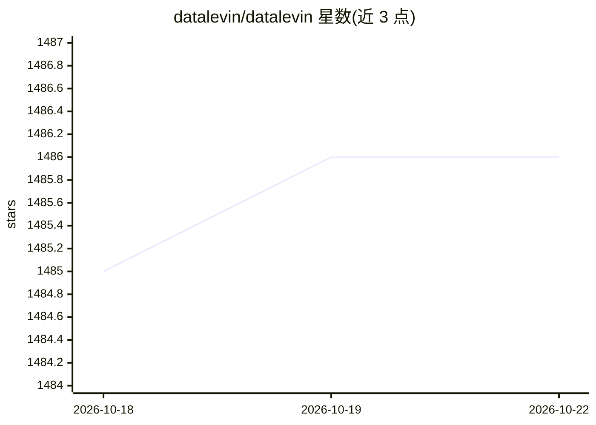

# datalevin/datalevin

⭐ 1,486 · Clojure · EPL-2.0 · 推送 2026-10-21 · [GitHub](https://github.com/datalevin/datalevin) · [官网](https://datalevin.org) · 组织维护

**给开发者的多范式 Datalog 数据库，内嵌向量搜索与本地 LLM**

基于 LMDB 分叉的持久化 Datalog 数据库，支持 Datomic 风格查询语言、ACID 事务、WAL 与异步写入；同时可作为文档数据库（JSON/EDN/Markdown 路径索引）、键值存储、SIMD 加速的向量数据库与全文搜索引擎使用。AI 相关能力包括内置本地 MCP 服务器、库内 embedding 与基于内置 llama.cpp 的文本生成。可嵌入 Java/Python/Node.js/Clojure 应用，也可运行于默认端口 8898 的客户端/服务器模式，支持 Raft 共识高可用集群与 RBAC。附有与 PostgreSQL、SQLite、Neo4j、MongoDB 等的性能基准。

## 筛选速览

| 维度 | 判定 | 备注 |
|---|---|---|
| AI 角色 | `ai-enhanced` | 去掉 AI 部分产品仍成立 |
| 许可风险 | `viral` | EPL-2.0 |
| 部署形态 | `library` | 以包/库形式分发 |
| 模型依赖 | — | README 未给出锁定关系 |
| 硬件要求 | — | 无带数字的原话,不猜 |
| 安装摩擦 | `low` | 无编译、无系统依赖或容器化 |
| 成熟度 | — | 结构信号不足 |

## 能力要点

- Datalog 查询引擎 + 成本优化器，支持递归规则用于图查询与演绎推理
- SIMD 加速向量索引与搜索，内置全文搜索引擎
- 内置本地 MCP 服务器，支持库内 embedding 与内置 llama.cpp 文本生成
- 嵌入模式（Java/Python/Node.js/Clojure）与 Raft 高可用服务器模式两种运行形态

## 适用场景

- 在 Clojure/Java/Python/Node.js 应用中嵌入使用，像 SQLite 一样管理状态
- 作为 Datalog 文档/图/向量多范式数据库支撑业务系统
- 通过内置 MCP 服务器让 AI agent 直接查询数据库

## 场景标签

`向量数据库` · 领域:知识与检索

## 证据(README 行号)

> L91: Datalevin is also AI-native. It ships with a built-in local [MCP
> L92: server](doc/mcp.md). Datalevin supports in-DB embedding and text generation with
> L85: Datalevin supports vector database features by integrating an

## 星数曲线

2026-10-18 1,485 → 2026-10-22 1,486（+1）

---
*卡片 v1 · prompt 1.4 · 生成 2026-10-21 · 置信度 high · 依据 README sha `8054afb1a6bd` · [字段定义](../../DATASET.md)*
