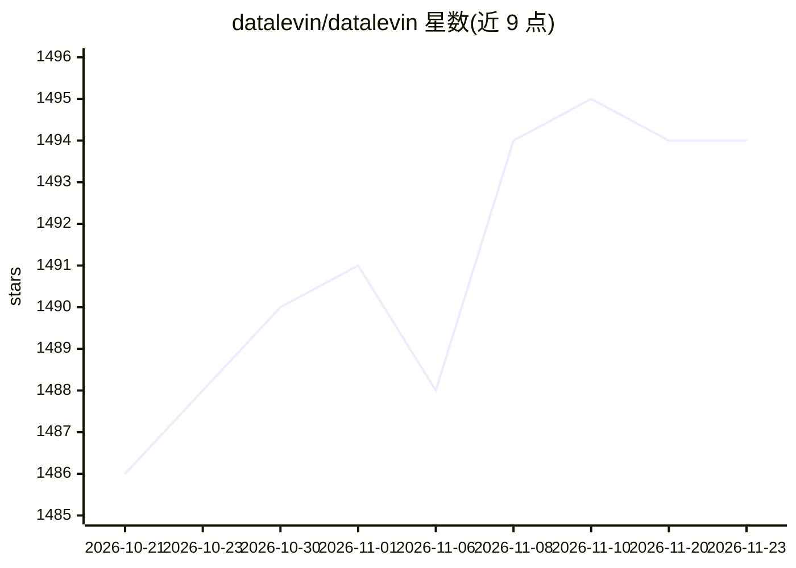

# datalevin/datalevin

⭐ 1,494 · Clojure · EPL-2.0 · 推送 2026-11-21 · [GitHub](https://github.com/datalevin/datalevin) · [官网](https://datalevin.org) · 组织维护

**支持内嵌 AI 能力的 Datalog 多模型数据库**

Datalevin 是构建在 LMDB 分支之上的持久化 Datalog 数据库，支持多种使用形态：作为库嵌入应用（类似 SQLite）、以客户端/服务器模式运行（默认端口 8898，含 Raft 高可用集群与 RBAC），或作为 babashka pod 用于脚本。提供 ACID 事务、成本优化查询引擎、文档存储（JSON/EDN/Markdown 自动索引）、全文检索、向量检索与键值存储。内置本地 MCP server，并集成 llama.cpp 支持库内嵌入与文本生成。提供 Java、Python、Node.js 与 Clojure 客户端。

## 筛选速览

| 维度 | 判定 | 备注 |
|---|---|---|
| AI 角色 | `ai-enhanced` | 去掉 AI 部分产品仍成立 |
| 许可风险 | `viral` | EPL-2.0 |
| 部署形态 | `library` | 以包/库形式分发 |
| 模型依赖 | — | README 未给出锁定关系 |
| 硬件要求 | — | 无带数字的原话,不猜 |
| 安装摩擦 | `low` | 无编译、无系统依赖或容器化 |
| 成熟度 | — | 结构信号不足 |

## 能力要点

- 多种数据库范式：Datalog、文档、图、向量、键值、全文检索
- 内置 MCP server 与 llama.cpp，支持库内嵌入和文本生成
- 嵌入库、C/S 集群（Raft+RBAC）、babashka pod 三种运行形态
- 基于 LMDB 分支的 ACID 事务，支持 WAL 与异步写入

## 适用场景

- 为 Clojure/Java/Python/Node 应用提供嵌入式状态管理
- 需要 Datalog 递归推理与图查询的数据存储
- 在同一数据库中结合文档、全文与向量检索
- 作为带 RBAC 与高可用集群的网络数据库部署

## 场景标签

`向量数据库` · 领域:知识与检索

## 证据(README 行号)

> L91: Datalevin is also AI-native. It ships with a built-in local [MCP
> L85: Datalevin supports vector database features by integrating an
> L99: Datalevin can be used as a library, embedded in applications to manage state,

## 星数曲线

2026-10-21 1,486 → 2026-11-23 1,494（+8）

---
*卡片 v1 · prompt 1.4 · 生成 2026-11-23 · 置信度 high · 依据 README sha `aaf57314bcc0` · [字段定义](../../DATASET.md)*
