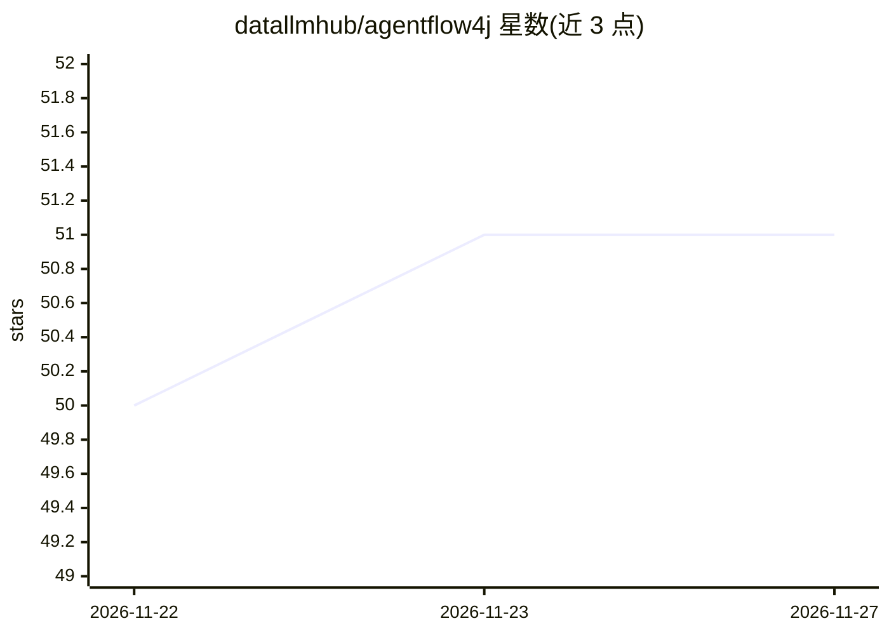

# datallmhub/agentflow4j

⭐ 51 · Java · Apache-2.0 · 推送 2026-11-23 · [GitHub](https://github.com/datallmhub/agentflow4j) · [官网](https://datallmhub.github.io/agentflow4j/) · 组织维护

**JVM 上的治理型多智能体框架与运行时**

面向 JVM/Spring 生态的框架与运行时，用于构建有状态的多智能体系统。关键机制包括：ToolPolicy/StatePolicy 控制工具与状态写入、BudgetPolicy 限制支出、ApprovalGate 在敏感节点暂停等待人工批准、JDBC/Redis 检查点存储支持故障与重启后恢复执行。提供 Squad 与 Graph 两级 API，1.0 起核心模块 API 稳定。运行需 Java 17+，通过 Maven Central 发布，另有可本地运行的样例与食谱。

## 筛选速览

| 维度 | 判定 | 备注 |
|---|---|---|
| AI 角色 | `ai-ecosystem` | LLM/agent 周边工具 |
| 许可风险 | `permissive` | Apache-2.0 |
| 部署形态 | `None` |  |
| 模型依赖 | local-ok | 支持本地模型 |
| 硬件要求 | — | 无带数字的原话,不猜 |
| 安装摩擦 | `medium` | 含编译或系统依赖之一 |
| 成熟度 | `idea` | |

## 能力要点

- 治理机制：ToolPolicy、StatePolicy、BudgetPolicy、ApprovalGate
- 持久化执行：JDBC/Redis 检查点，重启后从上个检查点恢复
- 两级 API：Squad API 动态路由、Graph API 显式流程与循环
- 支持 MCP 工具治理与 Micrometer 可观测性

## 适用场景

- 构建需要人工审批关键操作的多智能体工作流
- 跨故障与重启保持智能体执行状态
- 按预算控制 LLM 调用支出并路由到可用模型
- 对 MCP 服务器暴露的工具施加策略与审计

## 场景标签

`Agent 框架` `多智能体` `工作流自动化` · 领域:Agent 开发

## 证据(README 行号)

> L5: AF4J is a framework and runtime for governed, stateful multi-agent systems on the JVM.
> L7: Human approvals · Checkpoints · Budget controls · Tool policies · Durable execution
> L15: - Run natively on the JVM and Spring ecosystem

## 星数曲线

2026-11-22 50 → 2026-11-27 51（+1）

---
*卡片 v1 · prompt 1.4 · 生成 2026-11-22 · 置信度 high · 依据 README sha `3f97517741be` · [字段定义](../../DATASET.md)*
