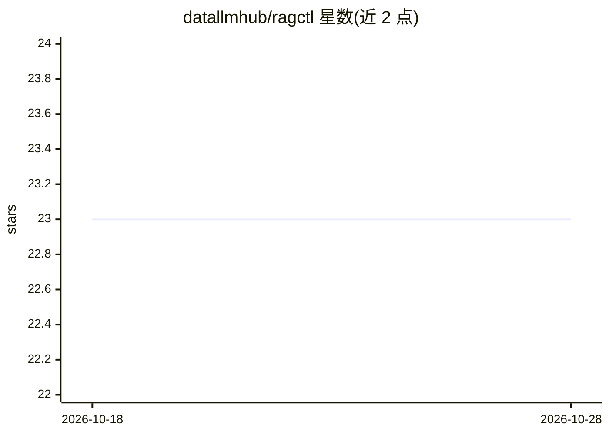

# datallmhub/ragctl

⭐ 23 · Python · MIT · 推送 2026-01-12 · [GitHub](https://github.com/datallmhub/ragctl) · [官网](https://pypi.org/project/ragctl/0.1.5) · 组织维护

**面向 RAG 的文档处理 CLI：加载、OCR、切块并导出入库**

命令行工具 ragctl，将 PDF、DOCX、图像、HTML、Markdown 等文档转换为可用于 RAG 系统的文本块。核心机制：OCR 三级回退（EasyOCR → PaddleOCR → pytesseract）、基于 LangChain RecursiveCharacterTextSplitter 的语义/句子/token 三种切块策略、批量处理带自动重试与运行历史、输出 JSON/JSONL/CSV 或直接写入 Qdrant 向量库。面向构建 RAG 应用的开发者，通过 pip 安装，可选评估切块质量的 eval 命令。OCR 场景需系统级依赖（tesseract、poppler）且建议 NumPy 1.x。

## 筛选速览

| 维度 | 判定 | 备注 |
|---|---|---|
| AI 角色 | `ai-ecosystem` | LLM/agent 周边工具 |
| 许可风险 | `permissive` | MIT |
| 部署形态 | `library` | 以包/库形式分发 |
| 模型依赖 | — | README 未给出锁定关系 |
| 硬件要求 | — | 无带数字的原话,不猜 |
| 安装摩擦 | `medium` | 含编译或系统依赖之一 |
| 成熟度 | — | 结构信号不足 |

## 能力要点

- OCR 三级回退：EasyOCR → PaddleOCR → pytesseract，自动拒绝不可读文档
- 三种切块策略（semantic/sentence/token），token 上限与重叠可配置
- 批量处理带最多 3 次指数退避重试与运行历史，支持仅重跑失败文件
- 导出 JSON/JSONL/CSV 或直接摄取进 Qdrant 向量库

## 适用场景

- 把 PDF/扫描件等文档批量转换为 RAG 用的文本块
- 切块后直接写入 Qdrant 构建检索库
- 对比不同切块策略的质量表现

## 场景标签

`RAG` `OCR` `文档解析` · 领域:知识与检索

## 证据(README 行号)

> L18: ragctl is a **command-line tool** for processing documents into chunks ready for Retrieval-Augmented Generation (RA
> L23: - Intelligent semantic chunking using LangChain

## 星数曲线

2026-10-18 23 → 2026-10-28 23（+0）

---
*卡片 v1 · prompt 1.4 · 生成 2026-10-27 · 置信度 high · 依据 README sha `221f0349c3c1` · [字段定义](../../DATASET.md)*
