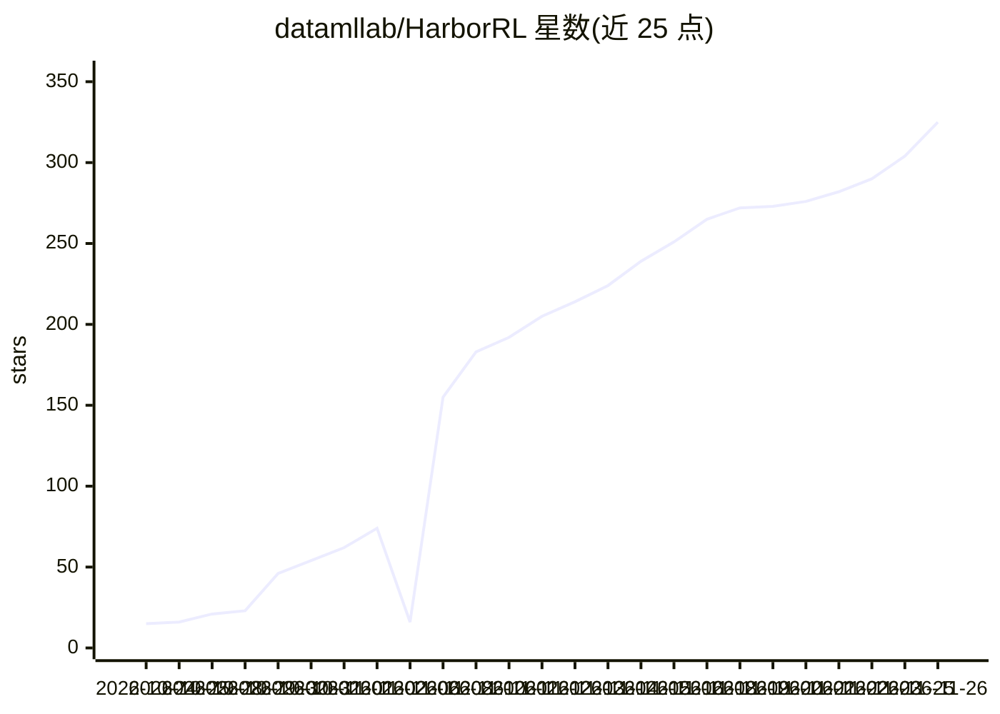

# datamllab/HarborRL

⭐ 325 · Python · MIT · 推送 2026-11-24 · [GitHub](https://github.com/datamllab/HarborRL) · 组织维护 · 中文 README

**轻量级 Agent 强化学习训练框架：在沙箱可验证任务上训练工具使用型 Agent**

HarborRL 将模型服务、轨迹生成、工具执行、验证器奖励与策略更新整合为一条可复现的训练流水线，用于训练工具使用型 Agent。支持模型（Qwen、GLM）、算法（GRPO、DAPO）、任务（200+ Harbor 格式任务，含 Terminal-Bench、SWE-Bench）、harness（40+ 框架，含 Claude Code、Codex、LangGraph）四个维度的组合，提供 CLI 与本地 Web 控制台做配置、校验、dry-run 与启动，默认 CPU 安装不依赖 CUDA/Docker/模型权重。

## 筛选速览

| 维度 | 判定 | 备注 |
|---|---|---|
| AI 角色 | `ai-ecosystem` | LLM/agent 周边工具 |
| 许可风险 | `permissive` | MIT |
| 部署形态 | `None` |  |
| 模型依赖 | — | README 未给出锁定关系 |
| 硬件要求 | — | 无带数字的原话,不猜 |
| 安装摩擦 | `medium` | 含编译或系统依赖之一 |
| 成熟度 | — | 结构信号不足 |

## 能力要点

- Models × Algorithms × Tasks × Harnesses 四维组合的训练配置
- 200+ Harbor 格式沙箱任务与 40+ harness 框架接入
- 默认 CPU 开发安装无需 CUDA、Docker、模型权重
- 离线配置向导、本地 Web 控制台与 doctor 配置校验

## 适用场景

- 在数学推理等可验证任务上对 Agent 做 RL 训练
- 组合不同 base 模型、算法与 harness 框架做实验
- 本地 Web 控制台演示任务的执行与奖励检查

## 场景标签

`强化学习` · 领域:训练与推理

## 证据(README 行号)

> L28: HarborRL is a lightweight framework for training tool-using agents on verifiable, sandboxed tasks. It makes model s
> L30: HarborRL supports flexible combinations of **Models × Algorithms × Tasks × Harnesses (MATH)**:

## 星数曲线

2026-10-24 15 → 2026-11-26 325（+310）

---
*卡片 v1 · prompt 1.4 · 生成 2026-11-26 · 置信度 high · 依据 README sha `c08d32b86aa0` · [字段定义](../../DATASET.md)*
