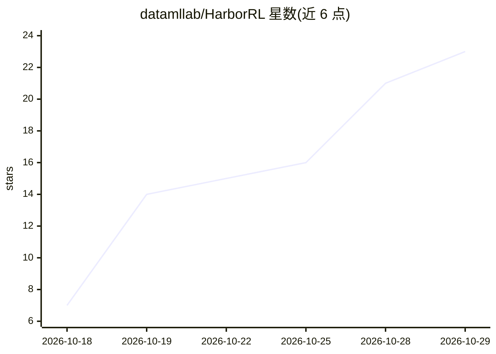

# datamllab/HarborRL

⭐ 23 · Python · MIT · 推送 2026-10-27 · [GitHub](https://github.com/datamllab/HarborRL) · 组织维护 · 中文 README

**端到端 Agentic 强化学习框架：训练工具使用智能体**

HarborRL 是一个轻量级 agentic 强化学习训练框架，面向研究者和开发者，在可验证、沙箱隔离的任务上训练工具使用智能体，将模型服务、轨迹生成、工具执行、验证器奖励与策略更新整合为单一可复现流水线。支持 Models×Algorithms×Tasks×Harnesses 灵活组合：Qwen/GLM 基座模型、GRPO/DAPO 算法、200+ Harbor 格式任务与 40+ harness 框架。提供配置 CLI 与本地 Web 控制台；CPU 开发安装不依赖 CUDA、Docker 与模型权重。

## 筛选速览

| 维度 | 判定 | 备注 |
|---|---|---|
| AI 角色 | `ai-ecosystem` | LLM/agent 周边工具 |
| 许可风险 | `permissive` | MIT |
| 部署形态 | `self-host` | docker 或自建部署 |
| 模型依赖 | — | README 未给出锁定关系 |
| 硬件要求 | — | 无带数字的原话,不猜 |
| 安装摩擦 | `low` | 无编译、无系统依赖或容器化 |
| 成熟度 | — | 结构信号不足 |

## 能力要点

- 模型服务、轨迹生成、工具执行、验证器奖励、策略更新整合为单一流水线
- 支持 Qwen/GLM 基座、GRPO/DAPO 算法、200+ 任务、40+ harness 组合
- 配置 CLI、本地 Web 控制台与 doctor 部署校验
- CPU 开发安装无需 CUDA/Docker/模型权重

## 适用场景

- 在 Terminal-Bench、SWE-Bench 等可验证任务上做 agentic RL 训练
- 组合不同模型、算法、任务与 harness（如 Claude Code、LangGraph）跑 RL 实验
- 用 YAML 定义可复现的完整训练实验并多机 GPU 部署

## 场景标签

`Agent 框架` `强化学习` · 领域:Agent 开发

## 证据(README 行号)

> L22: HarborRL is a lightweight framework for training tool-using agents on verifiable, sandboxed tasks. It makes model s
> L27: - **Algorithms:** GRPO and DAPO for RL training.

## 星数曲线

2026-10-18 7 → 2026-10-29 23（+16）

---
*卡片 v1 · prompt 1.4 · 生成 2026-10-28 · 置信度 mid · 依据 README sha `8edd8a05dfe8` · [字段定义](../../DATASET.md)*
