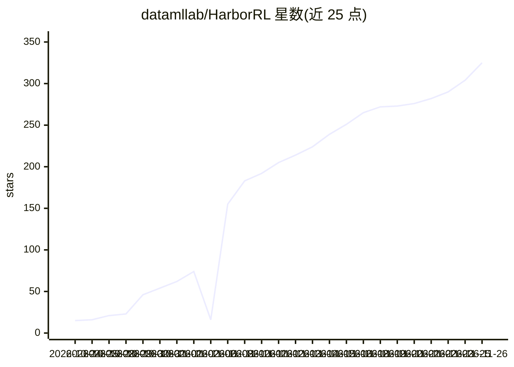

# datamllab/HarborRL

⭐ 325 · Python · MIT · 推送 2026-11-24 · [GitHub](https://github.com/datamllab/HarborRL) · 组织维护 · 中文 README

**面向开发者的工具使用型 Agent 强化学习训练框架**

HarborRL 是一个轻量级的 Agentic RL 框架，将模型服务、轨迹生成、工具执行、验证器奖励与策略更新整合为可复现流水线，用于在沙箱化可验证任务上训练工具使用型 Agent。实验按模型×算法×任务×Harness 四维组合：模型支持 Qwen 与 GLM，算法支持 GRPO 与 DAPO，任务为 200+ Harbor 格式任务，Harness 兼容 40+ 框架。提供 CLI 与本地 Web 控制台完成配置、校验、试运行与训练启动；CPU 开发安装无需 CUDA、Docker 或模型权重。

## 筛选速览

| 维度 | 判定 | 备注 |
|---|---|---|
| AI 角色 | `ai-ecosystem` | LLM/agent 周边工具 |
| 许可风险 | `permissive` | MIT |
| 部署形态 | `None` |  |
| 模型依赖 | — | README 未给出锁定关系 |
| 硬件要求 | — | 无带数字的原话,不猜 |
| 安装摩擦 | `medium` | 含编译或系统依赖之一 |
| 成熟度 | — | 结构信号不足 |

## 能力要点

- 模型×算法×任务×Harness 四维组合（200+ 任务、40+ Harness）
- GRPO 与 DAPO 训练算法，统一 Slime 流水线
- CLI 与本地 Web 控制台，支持配置校验与 dry-run
- CPU Hello World 示例无需 GPU 与模型推理

## 适用场景

- 在 Terminal-Bench、SWE-Bench 等沙箱任务上训练工具使用型 Agent
- 用 GRPO/DAPO 对 Qwen、GLM 基座做数学推理 RL 训练
- 配合 Claude Code、SWE-agent 等 Harness 框架做 RL
- 离线配置向导与 Web 控制台管理训练部署

## 场景标签

`Agent 框架` `强化学习` · 领域:Agent 开发

## 证据(README 行号)

> L26: HarborRL is a lightweight framework for training tool-using agents on verifiable, sandboxed tasks. It makes model s
> L28: HarborRL supports flexible combinations of **Models × Algorithms × Tasks × Harnesses (MATH)**:
> L33: - **Harnesses:** RL training with **40+** harness frameworks, including Claude Code, Codex, LangGraph, SWE-agent, a

## 星数曲线

2026-10-24 15 → 2026-11-26 325（+310）

---
*卡片 v1 · prompt 1.4 · 生成 2026-11-25 · 置信度 high · 依据 README sha `289d4f211f88` · [字段定义](../../DATASET.md)*
