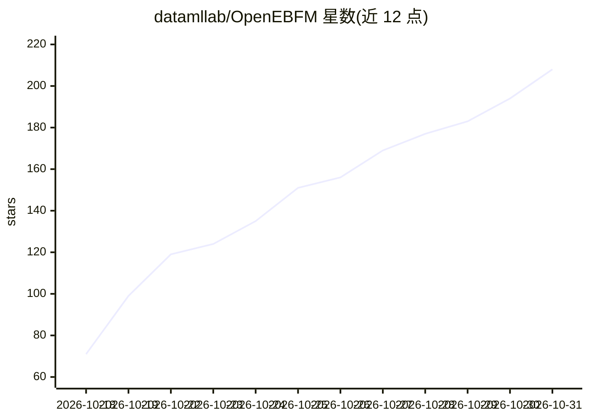

# datamllab/OpenEBFM

⭐ 208 · Python · MIT · 推送 2026-10-28 · [GitHub](https://github.com/datamllab/OpenEBFM) · 组织维护 · 中文 README

**能量基基础模型的训练与扩展开源代码库**

提供能量基基础模型（Energy-based Foundation Models）的完整训练代码：通过 uv sync 安装依赖，用脚本下载并分词 ClimbMix、DCLM、FineWeb、OWT 等预训练数据集，以 TARGET_TOTAL_TOKENS 控制训练预算；README 展示验证 BPB 与零样本准确率随模型规模和训练 token 数的扩展规律。在 Hugging Face 发布 160M/520M/1B 预训练检查点及一个 1B CHAT SFT 模型，支持从 HF ID 直接加载，并带浏览器 Chat Demo。训练需 GPU，支持 CUDA 与 CPU 两套 PyTorch 索引。

## 筛选速览

| 维度 | 判定 | 备注 |
|---|---|---|
| AI 角色 | `ai-ecosystem` | LLM/agent 周边工具 |
| 许可风险 | `none` | MIT |
| 部署形态 | `None` |  |
| 模型依赖 | — | README 未给出锁定关系 |
| 硬件要求 | — | 无带数字的原话,不猜 |
| 安装摩擦 | `medium` | 含编译或系统依赖之一 |
| 成熟度 | — | 结构信号不足 |

## 能力要点

- 完整的预训练/SFT/评测/QA/Chat 脚本与 YAML 配置
- Hugging Face 发布 160M–1B 预训练检查点与 1B CHAT 模型
- 按 TARGET_TOTAL_TOKENS 控制训练预算，输出目录含 HF 格式导出
- 支持 DCLM、FineWeb、ClimbMix、OWT 预训练数据集

## 适用场景

- 复现或扩展能量基语言模型的预训练实验
- 研究能量基模型的 scaling law
- 用发布的检查点跑 chat demo 或零样本评测

## 场景标签

`模型训练` `微调` · 领域:训练与推理

## 证据(README 行号)

> L7:  Open-source code for training and scaling Energy-based Foundation Models
> L44: TARGET_TOTAL_TOKENS=100000000 bash runs/train.sh
> L67: Pretrained models are published in the

## 星数曲线

2026-10-18 71 → 2026-10-31 208（+137）

---
*卡片 v1 · prompt 1.4 · 生成 2026-10-23 · 置信度 mid · 依据 README sha `8c1c1734a725` · [字段定义](../../DATASET.md)*
