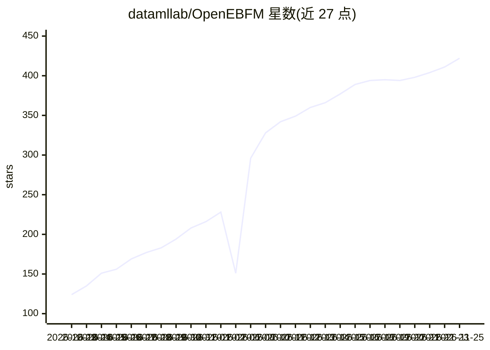

# datamllab/OpenEBFM

⭐ 422 · Python · MIT · 推送 2026-11-03 · [GitHub](https://github.com/datamllab/OpenEBFM) · 组织维护 · 中文 README

**能量式基础模型的训练与扩展开源代码库**

提供训练和扩展能量式基础模型（EBFM）的完整代码：数据准备脚本读取 climbmix、dclm、fineweb 等语料并分词，训练脚本通过 TARGET_TOTAL_TOKENS 控制训练预算，支持 pretrain 与 sft 两种任务，训练结束后导出 Hugging Face 格式检查点。附带的评测脚本计算验证 BPB 与 zero-shot 准确率，并提供浏览器聊天 demo 运行已发布的 SFT 模型。作者发布了 160M/520M/1B 等预训练检查点，用于展示缩放规律实验结果。

## 筛选速览

| 维度 | 判定 | 备注 |
|---|---|---|
| AI 角色 | `ai-native` | 本体是模型或模型工具 |
| 许可风险 | `permissive` | MIT |
| 部署形态 | `None` |  |
| 模型依赖 | — | README 未给出锁定关系 |
| 硬件要求 | — | 无带数字的原话,不猜 |
| 安装摩擦 | `medium` | 含编译或系统依赖之一 |
| 成熟度 | — | 结构信号不足 |

## 能力要点

- 支持 pretrain 与 sft 两种训练任务，训练长度由 token 预算控制
- 支持从 Hugging Face ID 直接加载已发布检查点（160M/520M/1B）
- 提供 BPB 验证与 zero-shot 准确率评测脚本
- 内置浏览器聊天 demo，运行 SFT 模型

## 适用场景

- 复现论文中的能量式语言模型预训练实验
- 在自己的语料上训练和微调小型能量式语言模型
- 研究不同训练 token 量与模型规模下的缩放规律
- 加载已发布检查点进行评测或网页对话测试

## 场景标签

`模型训练` `微调` `模型评测` · 领域:评测与运维

## 证据(README 行号)

> L7:  Open-source code for training and scaling Energy-based Foundation Models
> L43: TARGET_TOTAL_TOKENS=100000000 bash runs/train.sh
> L122: select a pretraining corpus with `dataset` (`dclm`, `climbmix`, `fineweb`, or

## 星数曲线

2026-10-23 124 → 2026-11-25 422（+298）

---
*卡片 v1 · prompt 1.4 · 生成 2026-11-25 · 置信度 high · 依据 README sha `75f7c34f3940` · [字段定义](../../DATASET.md)*
