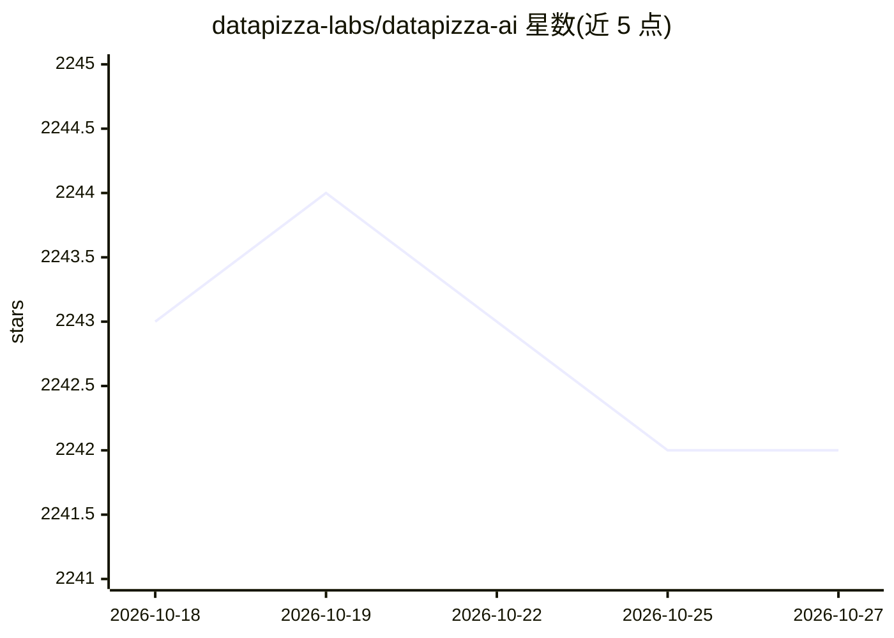

# datapizza-labs/datapizza-ai

⭐ 2,242 · Python · MIT · 推送 2026-05-19 · [GitHub](https://github.com/datapizza-labs/datapizza-ai) · [官网](http://docs.datapizza.ai/) · 组织维护

**面向开发者的 Python GenAI Agent/RAG 应用框架**

用 Python 编写的 GenAI 应用开发框架，提供 Agent 抽象、多提供商模型客户端（OpenAI、Gemini、Anthropic、Mistral、Azure）、工具集成（Web 搜索、自定义工具）、记忆管理、文档解析（PDF/DOCX/图像，基于 Azure AI 与 Docling）、分块与嵌入、向量存储（Qdrant）与 RAG 管道。可观测性方面内置 OpenTelemetry 追踪与客户端 I/O 日志开关。通过 pip 以模块化可选组件方式安装（核心包+独立工具/解析器包）。要求 Python 3.10+，MIT 许可，由 Datapizza 团队维护。

## 筛选速览

| 维度 | 判定 | 备注 |
|---|---|---|
| AI 角色 | `ai-ecosystem` | LLM/agent 周边工具 |
| 许可风险 | `permissive` | MIT |
| 部署形态 | `library` | 以包/库形式分发 |
| 模型依赖 | — | README 未给出锁定关系 |
| 硬件要求 | — | 无带数字的原话,不猜 |
| 安装摩擦 | `low` | 无编译、无系统依赖或容器化 |
| 成熟度 | — | 结构信号不足 |

## 能力要点

- 多提供商客户端支持：OpenAI、Google Gemini、Anthropic、Mistral、Azure
- 内置 OpenTelemetry 追踪与客户端 I/O 日志的可观测性
- 文档摄入→分块→嵌入→向量存储的 RAG 管道组件
- 模块化可选组件安装（工具/解析器独立 pip 包）

## 适用场景

- 构建多 Agent 协作的应用（如行程规划示例）
- 搭建带文档检索的 RAG 问答管道
- 需要切换模型提供商而不改业务逻辑的生产系统
- 对 LLM 应用执行流做追踪与调试

## 场景标签

`Agent 框架` `RAG` · 领域:Agent 开发

## 证据(README 行号)

> L5: *Written in Python. Designed for speed. A no-fluff GenAI framework that gets your agents from dev to prod, fast*
> L74: from datapizza.agents import Agent
> L121: Process and index documents for retrieval-augmented generation (RAG). This pipeline automatically parses PDFs, spl

## 星数曲线

2026-10-18 2,243 → 2026-10-27 2,242（-1）

---
*卡片 v1 · prompt 1.4 · 生成 2026-10-21 · 置信度 high · 依据 README sha `13a65fbfef37` · [字段定义](../../DATASET.md)*
