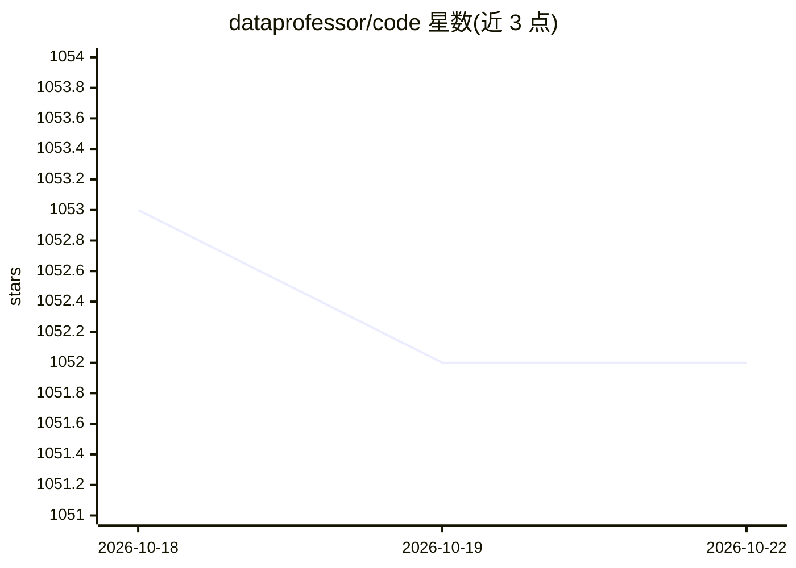

# dataprofessor/code

⭐ 1,052 · Jupyter Notebook · 推送 2026-01-10 · [GitHub](https://github.com/dataprofessor/code) · [官网](http://youtube.com/dataprofessor) · 组织维护

**Data Professor 频道 R/Python 数据科学教程代码合集**

汇集 Data Professor YouTube 频道教程视频中使用的 R 与 Python 编程代码：包含 Iris 与 DHFR 数据集的探索性数据分析及分类模型构建代码、多个 Python 数据科学项目教程代码，以及用 R 的 shiny 包构建 Web 应用的代码。内容按文件夹组织，README 注明后续会持续添加。面向频道观众与数据科学学习者，作为跟随教程的配套代码资源。

## 筛选速览

| 维度 | 判定 | 备注 |
|---|---|---|
| AI 角色 | `ai-knowledge` | 知识聚合/清单类 |
| 许可风险 | `none` | — |
| 部署形态 | `None` |  |
| 模型依赖 | — | README 未给出锁定关系 |
| 硬件要求 | — | 无带数字的原话,不猜 |
| 安装摩擦 | `low` | 无编译、无系统依赖或容器化 |
| 成熟度 | — | 结构信号不足 |

## 能力要点

- Iris/DHFR 数据集的探索性数据分析与分类模型代码
- 多个 Python 数据科学项目教程代码
- R shiny 包构建 Web 应用的示例代码

## 适用场景

- 跟随 Data Professor 教程视频时获取配套代码
- 参考 EDA 与分类建模的 R/Python 实现写法
- 学习用 shiny 构建 R Web 应用

## 场景标签

`教程课程` · 领域:学习与行业

## 证据(README 行号)

> L2: This is a compilation of R programming codes used on the **Data Professor** YouTube channel tutorial videos.
> L6: iris | Codes for performing *exploratory data analysis* (so as to gain *data understanding*) and for building *class
> L8: python | Codes for various Python data science project tutorials.

## 星数曲线

2026-10-18 1,053 → 2026-10-22 1,052（-1）

---
*卡片 v1 · prompt 1.4 · 生成 2026-10-21 · 置信度 high · 依据 README sha `dd6fc2c555a2` · [字段定义](../../DATASET.md)*
