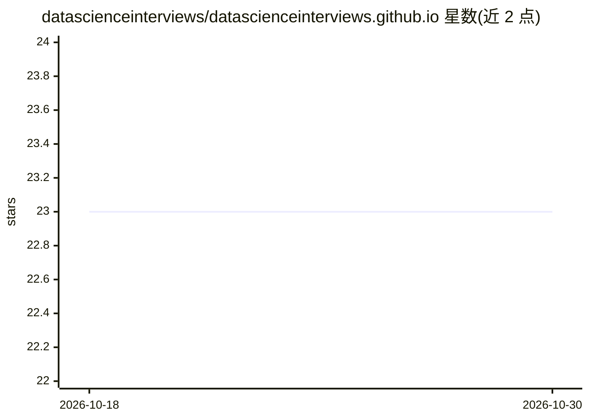

# datascienceinterviews/datascienceinterviews.github.io

⭐ 23 · HTML · AGPL-3.0 · 推送 2026-10-03 · [GitHub](https://github.com/datascienceinterviews/datascienceinterviews.github.io) · [官网](https://dsprep.com/) · 组织维护

**数据科学面试题解开源清单与学习资源平台**

开源平台，维护数据科学面试题与答案的策展清单，并汇总学习路径、在线资源、ML 主题、速查表、ML 模型部署、项目等内容。面向准备数据科学面试与求职的学习者，内容由社区维护：用户可改进现有问题答案、分享面试中遇到的新题，也可完善主题与文章。以 GitHub Pages 网站形式提供，支持在 Gitpod 中打开贡献。

## 筛选速览

| 维度 | 判定 | 备注 |
|---|---|---|
| AI 角色 | `ai-knowledge` | 知识聚合/清单类 |
| 许可风险 | `viral` | AGPL-3.0 |
| 部署形态 | `None` |  |
| 模型依赖 | — | README 未给出锁定关系 |
| 硬件要求 | — | 无带数字的原话,不猜 |
| 安装摩擦 | `low` | 无编译、无系统依赖或容器化 |
| 成熟度 | — | 结构信号不足 |

## 能力要点

- 策展的数据科学面试问答清单
- 附带学习路径、速查表、ML 主题、模型部署与项目等资源
- 社区共建：可提交新题、改进答案与文章
- 以 GitHub Pages 网站形式提供

## 适用场景

- 准备数据科学面试，查找并练习面试题
- 按建议学习路径系统学习数据科学主题
- 回顾速查表与 ML 模型部署资料
- 分享自己面试中遇到的题目回馈社区

## 场景标签

`精选清单` `教程课程` · 领域:学习与行业

## 证据(README 行号)

> L10: This is a completely open-source platform for maintaining curated list of interview questions and answers for peopl
> L30:  - 👨🏿‍🏫 Interview Questions

## 星数曲线

2026-10-18 23 → 2026-10-30 23（+0）

---
*卡片 v1 · prompt 1.4 · 生成 2026-10-27 · 置信度 high · 依据 README sha `ab1fc3946c9a` · [字段定义](../../DATASET.md)*
