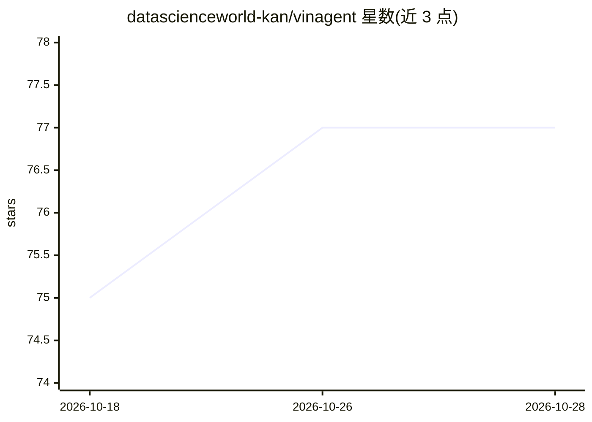

# datascienceworld-kan/vinagent

⭐ 77 · Python · MIT · 推送 2026-03-25 · [GitHub](https://github.com/datascienceworld-kan/vinagent) · [官网](https://datascienceworld-kan.github.io/vinagent) · 个人维护

**构建智能 Agent 的 Python 库：工具、记忆、工作流、观测一体化**

面向开发者的 Agent 开发库：通过装饰器、Python 模块或 MCP Server 注册工具，Agent 可同步/异步/流式调用，输出 AIMessage 或携带 artifact（DataFrame/图表）的 ToolMessage。内置知识图谱记忆（将对话历史转为图结构）、Guardrail 系统、多 Agent 团队协作与任务自动规划，并提供基于 LangGraph 的工作流构建语法（>> 连接节点）。示例覆盖金融分析、深度检索与热点新闻汇总，默认工具依赖 Together AI 与 Tavily 的 API key。版本 0.0.9 仍在快速迭代。

## 筛选速览

| 维度 | 判定 | 备注 |
|---|---|---|
| AI 角色 | `ai-ecosystem` | LLM/agent 周边工具 |
| 许可风险 | `permissive` | MIT |
| 部署形态 | `library` | 以包/库形式分发 |
| 模型依赖 | — | README 未给出锁定关系 |
| 硬件要求 | — | 无带数字的原话,不猜 |
| 安装摩擦 | `low` | 无编译、无系统依赖或容器化 |
| 成熟度 | — | 结构信号不足 |

## 能力要点

- 函数/模块/MCP 三种工具注册方式，@装饰器即可挂载运行时函数
- 知识图谱记忆：对话历史转化为知识图谱（如 BORN_IN/WORKS_FOR 三元组）
- 同步/异步/流式/异步流式四种调用方式
- 基于 LangGraph 的 FlowStateGraph 工作流，用 >> 运算符连接节点

## 适用场景

- 搭建带工具调用的金融分析或数据查询 Agent
- 将用户行为沉淀为知识图谱以增强 Agent 个性化能力
- 通过 MCP Server 接入 Google Drive、Gmail、Slack 等外部工具
- 用简洁语法编排 ReAct、思维链、反思等多 Agent 工作流

## 场景标签

`Agent 框架` `多智能体` `Agent 记忆` · 领域:Agent 开发

## 证据(README 行号)

> L13: `vinagent` is a lightweight and flexible library designed for building smart agent assistants across various indust
> L295: The Vinagent library enables the integration of workflows built upon the nodes and edges of LangGraph. What sets i

## 星数曲线

2026-10-18 75 → 2026-10-28 77（+2）

---
*卡片 v1 · prompt 1.4 · 生成 2026-10-24 · 置信度 high · 依据 README sha `6a39754a2bee` · [字段定义](../../DATASET.md)*
