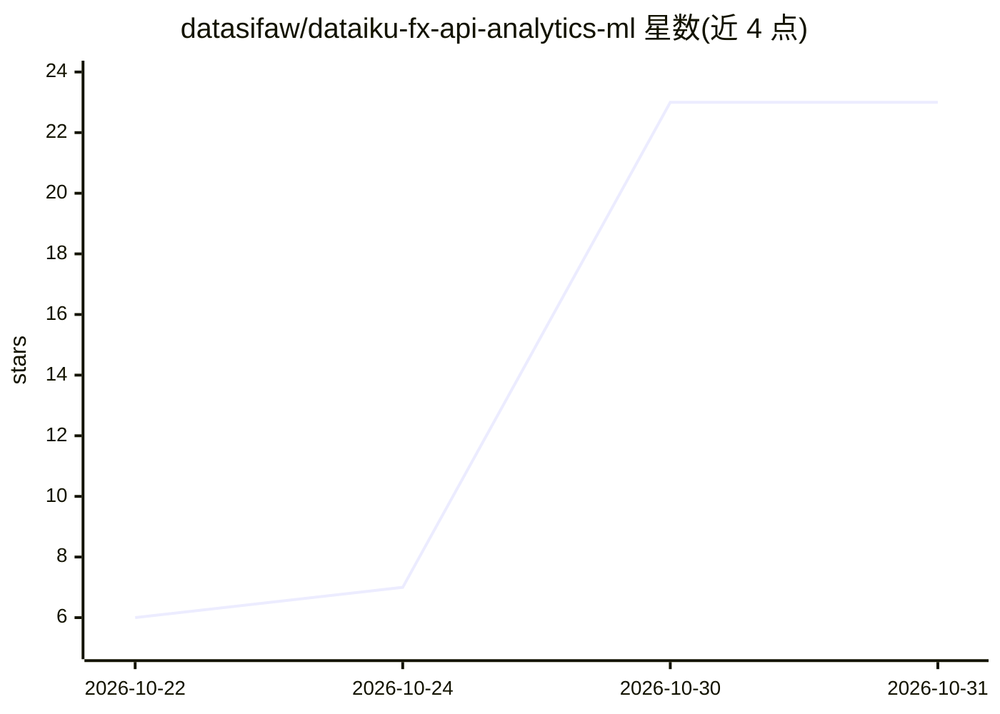

# datasifaw/dataiku-fx-api-analytics-ml

⭐ 23 · 推送 2026-10-25 · [GitHub](https://github.com/datasifaw/dataiku-fx-api-analytics-ml) · 个人维护

**Dataiku 端到端汇率数据项目：摄取、分析、仪表盘与机器学习**

基于 Dataiku 平台的端到端数据项目：通过 Frankfurter API 摄取汇率数据，进行 JSON 处理、分析、可视化仪表盘、机器学习建模与自动化流程。面向使用 Dataiku 的数据科学与数据分析人员，以项目工程形式提供。README 仅含标题与 'devise' 一词，功能细节主要来自仓库描述，具体安装方式、数据规模与机器学习模型细节在可见文本中未给出。

## 筛选速览

| 维度 | 判定 | 备注 |
|---|---|---|
| AI 角色 | `ai-enhanced` | 去掉 AI 部分产品仍成立 |
| 许可风险 | `none` | — |
| 部署形态 | `None` |  |
| 模型依赖 | — | README 未给出锁定关系 |
| 硬件要求 | — | 无带数字的原话,不猜 |
| 安装摩擦 | `low` | 无编译、无系统依赖或容器化 |
| 成熟度 | — | 结构信号不足 |

## 能力要点

- 通过 Frankfurter API 摄取汇率数据
- 覆盖 JSON 处理、分析与可视化仪表盘
- 包含机器学习与自动化流程环节

## 适用场景

- 在 Dataiku 中搭建汇率数据的摄取与分析流水线
- 为汇率数据构建仪表盘与机器学习模型

## 场景标签

`数据分析` · 领域:效率与自动化

## 证据(README 行号)

> L1: dataiku-fx-api-analytics-machine Learning

## 星数曲线

2026-10-22 6 → 2026-10-31 23（+17）

---
*卡片 v1 · prompt 1.4 · 生成 2026-10-30 · 置信度 low · 依据 README sha `fc56dcd7cd28` · [字段定义](../../DATASET.md)*
