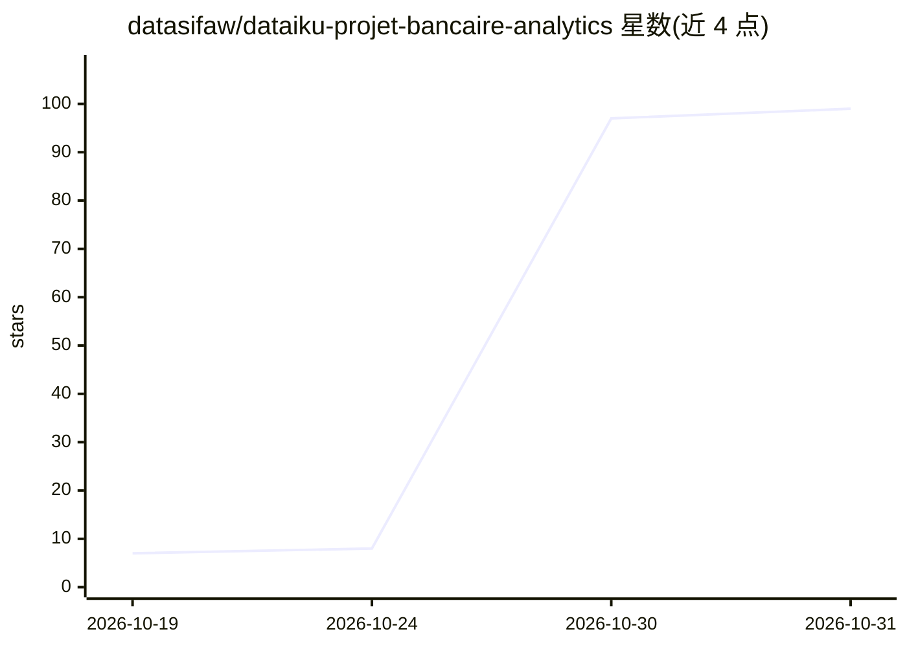

# datasifaw/dataiku-projet-bancaire-analytics

⭐ 99 · 推送 2026-10-25 · [GitHub](https://github.com/datasifaw/dataiku-projet-bancaire-analytics) · 个人维护

**基于 Dataiku 的银行数据分析端到端项目**

使用 Dataiku 平台开展的银行领域数据分析项目，覆盖数据准备、机器学习、客户评分与自动化流水线。README 以法语撰写，内容仅包含项目文档说明与版本演进记录（Version_1），未给出具体安装命令、数据集说明或运行方式，关键机制与限制无法从 README 中核实。

## 筛选速览

| 维度 | 判定 | 备注 |
|---|---|---|
| AI 角色 | `ai-native` | 本体是模型或模型工具 |
| 许可风险 | `none` | — |
| 部署形态 | `None` |  |
| 模型依赖 | — | README 未给出锁定关系 |
| 硬件要求 | — | 无带数字的原话,不猜 |
| 安装摩擦 | `low` | 无编译、无系统依赖或容器化 |
| 成熟度 | — | 结构信号不足 |

## 能力要点

- 覆盖数据准备、机器学习与客户评分的分析流程
- 项目基于 Dataiku 平台构建
- README 记录项目文档改进与版本演进（Version_1）

## 适用场景

- 作为 Dataiku 银行分析项目的参考案例
- 查看客户评分与自动化流水线的项目组织方式

## 场景标签

`数据分析` · 领域:效率与自动化

## 证据(README 行号)

> L11: Dataiku pour l'analyse bancaire.

## 星数曲线

2026-10-19 7 → 2026-10-31 99（+92）

---
*卡片 v1 · prompt 1.4 · 生成 2026-10-30 · 置信度 low · 依据 README sha `b7cc19847d94` · [字段定义](../../DATASET.md)*
