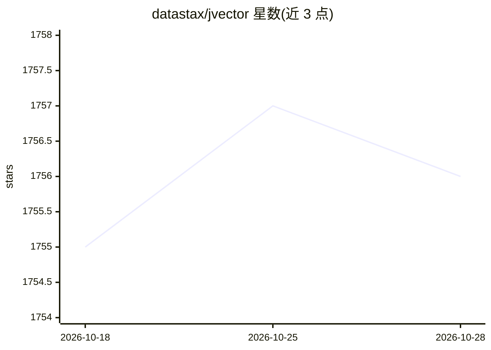

# datastax/jvector

⭐ 1,756 · Java · Apache-2.0 · 推送 2026-10-26 · [GitHub](https://github.com/datastax/jvector) · 组织维护

**嵌入式 Java 向量搜索引擎：图索引实现近似最近邻检索**

以 Java 库形式提供的嵌入式向量搜索引擎，融合 HNSW 层级结构与 DiskANN 的 Vamana 算法，构建多层图索引。底层邻接表存于磁盘、上层驻留内存，两遍检索先经内存中有损压缩向量（PQ/BQ/Fused PQ）导航，再读磁盘高精度表示（float32 或 NVQ）精排，以降低内存占用与延迟；索引构建本身也支持两遍检索，可构建超过内存容量的索引。以多模块 Maven 工程组织，产出兼容 Java 11 的 multirelease jar，Java 20+ 上启用 Vector API 优化，另带 Google Highway 原生 SIMD 库（Linux x86-64/AArch64）。

## 筛选速览

| 维度 | 判定 | 备注 |
|---|---|---|
| AI 角色 | `ai-ecosystem` | LLM/agent 周边工具 |
| 许可风险 | `permissive` | Apache-2.0 |
| 部署形态 | `None` |  |
| 模型依赖 | — | README 未给出锁定关系 |
| 硬件要求 | — | 无带数字的原话,不猜 |
| 安装摩擦 | `high` | 编译与系统依赖俱全 |
| 成熟度 | — | 结构信号不足 |

## 能力要点

- 融合 HNSW 层级与 DiskANN/Vamana 的多层图索引
- 两遍检索：内存有损压缩（PQ/BQ/Fused PQ）+ 磁盘高精度表示（float32/NVQ）
- 支持构建超出内存容量的单一大索引
- 非阻塞并发控制，构建随核数线性扩展

## 适用场景

- Java 应用内嵌入向量检索能力，避免外部数据库依赖
- 构建超出内存容量的大规模向量索引
- 本地或嵌入场景下的低延迟相似性搜索

## 场景标签

`向量数据库` · 领域:知识与检索

## 证据(README 行号)

> L13: JVector is a graph index that merges the DiskANN and HNSW family trees.
> L20: JVector implements a multi-layer graph with nonblocking concurrency control, allowing construction to scale linearl
> L24: The bottom layer of the graph is represented by an on-disk adjacency list per node. JVector uses additional data st

## 星数曲线

2026-10-18 1,755 → 2026-10-28 1,756（+1）

---
*卡片 v1 · prompt 1.4 · 生成 2026-10-21 · 置信度 high · 依据 README sha `dbded3803fac` · [字段定义](../../DATASET.md)*
