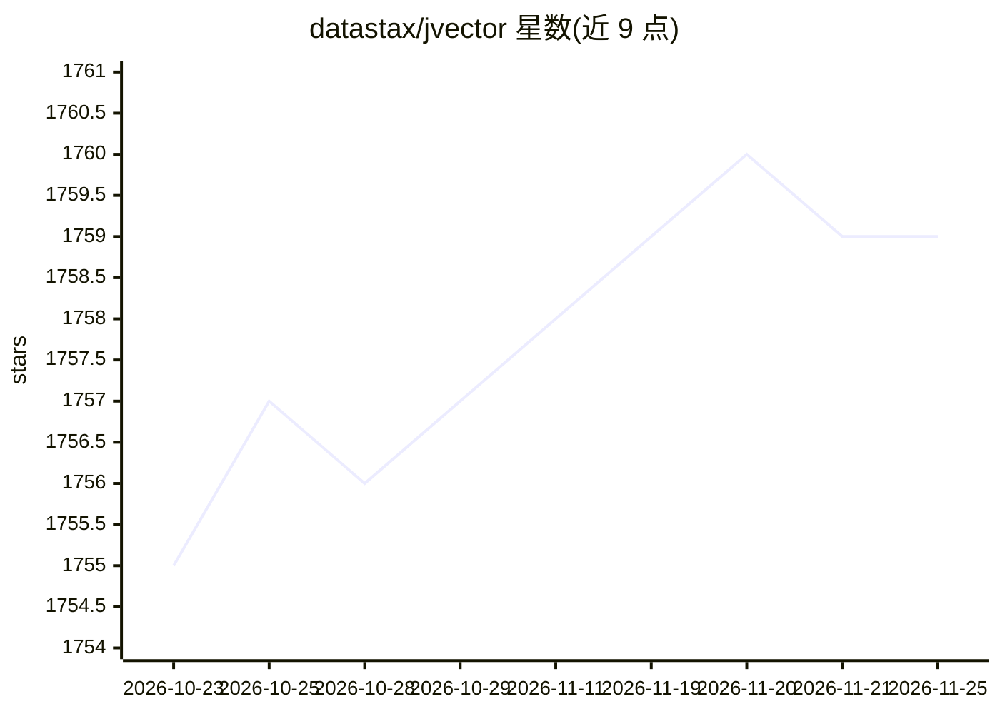

# datastax/jvector

⭐ 1,759 · Java · Apache-2.0 · 推送 2026-11-24 · [GitHub](https://github.com/datastax/jvector) · [官网](https://datastax.github.io/jvector/) · 组织维护

**Java 嵌入式 ANN 向量搜索库，构建可磁盘检索的图索引**

JVector 是一个 Java 近似最近邻（ANN）向量搜索库，索引结构结合 HNSW 式层级与每层 Vamana 图，支持并发与增量构建，并可从磁盘以压缩向量方式检索。搜索分两遍：先用量化码（PQ/ASH/BQ）遍历图，再用全精度或 NVQ 向量重排。构建需 JDK 22 与 Maven，库本身运行于 Java 11+；Linux x86-64/AArch64 可选编译 SIMD 原生库。通过 Maven Central 以 io.github.jbellis:jvector 发布，附带示例程序与教程。

## 筛选速览

| 维度 | 判定 | 备注 |
|---|---|---|
| AI 角色 | `ai-native` | 本体是模型或模型工具 |
| 许可风险 | `permissive` | Apache-2.0 |
| 部署形态 | `None` |  |
| 模型依赖 | — | README 未给出锁定关系 |
| 硬件要求 | — | 无带数字的原话,不猜 |
| 安装摩擦 | `high` | 编译与系统依赖俱全 |
| 成熟度 | — | 结构信号不足 |

## 能力要点

- HNSW 层级与 Vamana 图结合的索引结构，支持并发与增量构建
- 两遍搜索：量化码遍历 + FP32/NVQ 重排
- PQ、实验性 ASH、BQ、NVQ 多种量化器可选
- fused 索引将邻居码存入磁盘记录，支持大于内存的索引

## 适用场景

- 为 Java 应用嵌入向量相似度搜索
- 构建超过内存容量的大规模向量索引并从磁盘检索
- 在向量数据持续到达时进行流式索引构建与搜索

## 场景标签

`向量数据库` · 领域:知识与检索

## 证据(README 行号)

> L3: JVector is a Java library for approximate nearest neighbor (ANN) vector search. It builds graph
> L8: builds indexes faster. JVector targets newer JVMs, using native SIMD kernels on Java 22 and later,

## 星数曲线

2026-10-23 1,755 → 2026-11-25 1,759（+4）

---
*卡片 v1 · prompt 1.4 · 生成 2026-11-25 · 置信度 high · 依据 README sha `f38c07c611cd` · [字段定义](../../DATASET.md)*
