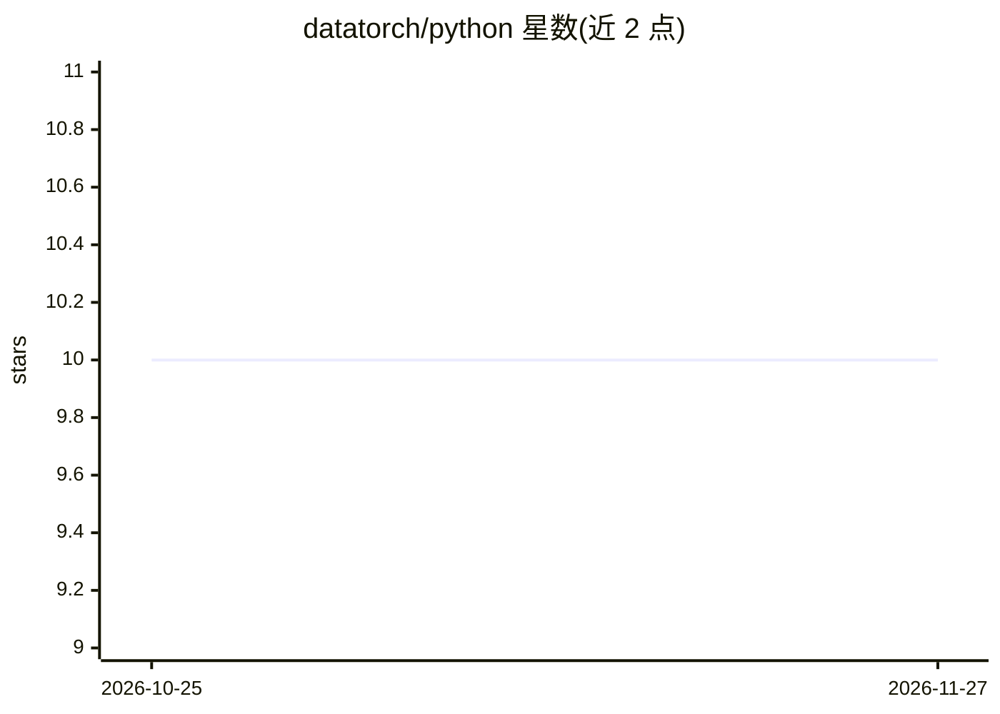

# datatorch/python

⭐ 10 · Python · 推送 2026-11-12 · [GitHub](https://github.com/datatorch/python) · [官网](https://docs.datatorch.io/python) · 组织维护

**DataTorch 数据标注平台的 Python API 与 CLI 客户端**

提供 CLI 和 Python API 库，用于以编程方式访问 DataTorch 平台（数据集标注与管理服务）。通过 pip 安装为 Python 包，较新版本（>=0.4.8.2）使用 libmagic 进行更准确的 mimetype 猜测，并在无法安装时回退到按扩展名猜测；开发模式下支持 editable 安装，构建产物为 wheel 并配合 pycocotools 一起测试。

## 筛选速览

| 维度 | 判定 | 备注 |
|---|---|---|
| AI 角色 | `ai-ecosystem` | LLM/agent 周边工具 |
| 许可风险 | `none` | — |
| 部署形态 | `library` | 以包/库形式分发 |
| 模型依赖 | — | README 未给出锁定关系 |
| 硬件要求 | — | 无带数字的原话,不猜 |
| 安装摩擦 | `low` | 无编译、无系统依赖或容器化 |
| 成熟度 | — | 结构信号不足 |

## 能力要点

- Python API 库与 CLI 双形态，程序化访问 DataTorch
- libmagic mimetype 猜测，未安装时回退扩展名猜测
- 支持 editable 开发安装与 wheel 构建流程

## 适用场景

- 用脚本批量管理 DataTorch 上的数据集
- 在深度学习训练流程中程序化读取标注数据
- 为 DataTorch 平台编写自动化集成脚本

## 场景标签

 · 领域:机器学习/数据标注与数据集管理

## 证据(README 行号)

> L3:  DataTorch CLI and Python API libary for programmatic access.
> L16: pip install datatorch

## 星数曲线

2026-10-25 10 → 2026-11-27 10（+0）

---
*卡片 v1 · prompt 1.4 · 生成 2026-11-19 · 置信度 mid · 依据 README sha `11e6d9645b4b` · [字段定义](../../DATASET.md)*
