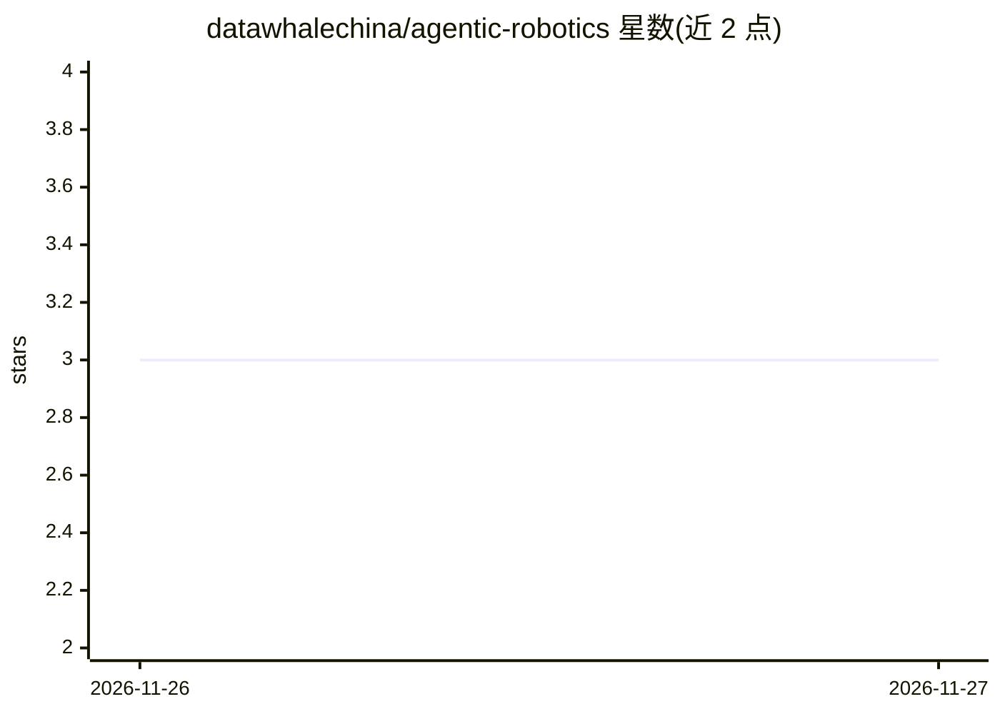

# datawhalechina/agentic-robotics

⭐ 3 · 推送 2026-11-25 · [GitHub](https://github.com/datawhalechina/agentic-robotics) · [官网](https://datawhalechina.github.io/agentic-robotics/) · 组织维护 · 中文 README

**面向工程师的开源教程：大模型如何指挥并改进机器人**

Datawhale 出品的开源教程，讲解大模型驱动的机器人智能体：通过工具调用执行任务、修订技能与训练策略、用独立评估验证改进效果，并区分一次改进、持续改进与递归自我改进（RSI）。理论部分 13 章已完成，仿真实验与真机实战仍在建设中。内容不绑定特定模型、框架或机器人本体，面向会 Python 和工具调用的智能体或机器人方向工程师与学生，可在线阅读，采用 CC BY-NC-SA 4.0 许可。

## 筛选速览

| 维度 | 判定 | 备注 |
|---|---|---|
| AI 角色 | `ai-knowledge` | 知识聚合/清单类 |
| 许可风险 | `none` | — |
| 部署形态 | `None` |  |
| 模型依赖 | — | README 未给出锁定关系 |
| 硬件要求 | — | 无带数字的原话,不猜 |
| 安装摩擦 | `low` | 无编译、无系统依赖或容器化 |
| 成熟度 | `idea` | |

## 能力要点

- 理论部分 13 章覆盖执行、改技能、改权重与闭环评估
- 提出 Harness 概念：连接大模型决定与机器人动作并检查完成
- 区分一次改进、持续改进与递归自我改进（RSI）及其证据要求
- 各章做法不依赖特定模型、框架或机器人，章末附参考文献

## 适用场景

- 系统学习把 LLM 智能体方法迁移到机器人系统
- 为机器人项目设计能力工具接口与调用门控
- 搭建机器人策略训练、数据采集与仿真场景的智能体流程
- 了解递归自我改进的证据标准与人机分工边界

## 场景标签

`教程课程` · 领域:学习与行业

## 证据(README 行号)

> L17: 《机器人智能体》是一份开源教程，介绍大模型怎样通过工具指挥机器人完成任务，任务完成得不好时怎样改进，以及怎样判断一次改进是否有效。本教程的出发点是两句话：智能体即是机器人，智能体改进机器人。
> L23: 各章介绍的是通用的做法，不依赖某一家的模型、框架或者机器人，引用的论文、文档和标准列在章末的参考文献里。

## 星数曲线

2026-11-26 3 → 2026-11-27 3（+0）

---
*卡片 v1 · prompt 1.4 · 生成 2026-11-26 · 置信度 high · 依据 README sha `4a5454ef909c` · [字段定义](../../DATASET.md)*
