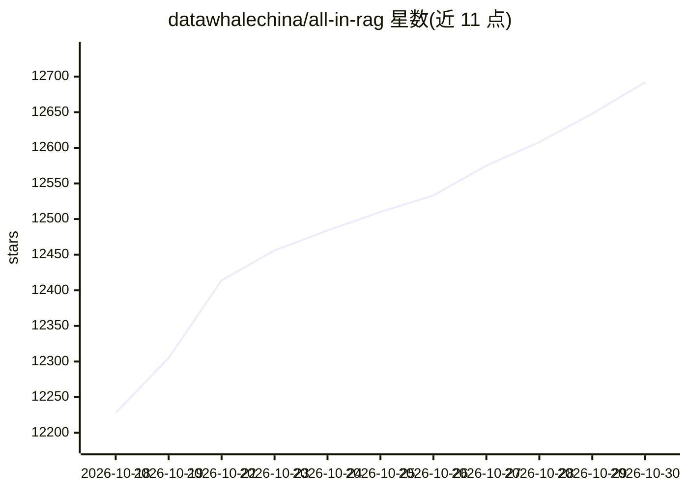

# datawhalechina/all-in-rag

⭐ 12,692 · Python · 推送 2026-09-30 · [GitHub](https://github.com/datawhalechina/all-in-rag) · [官网](https://datawhalechina.github.io/all-in-rag/) · 组织维护 · 中文 README

**面向开发者的 RAG 技术全栈教程与实战项目**

由 Datawhale 组织维护的 RAG（检索增强生成）技术教程仓库：内容覆盖 RAG 基础概念、数据处理全流程、向量与多模态嵌入、索引构建（含 Milvus 实践）、混合检索、Text2SQL、生成集成与系统评估，以及基于知识图谱的 RAG 与两个实战项目章节。仓库含 docs 教程文档与 code 代码示例目录，提供在线阅读地址，另设 Extra-chapter 接受社区投稿（Neo4j 应用、Jina v5-omni 多模态实践等）。第十章项目二标注为规划中。前置要求为 Python 基础、Docker 简单使用与 Linux 命令行能力。

## 筛选速览

| 维度 | 判定 | 备注 |
|---|---|---|
| AI 角色 | `ai-knowledge` | 知识聚合/清单类 |
| 许可风险 | `none` | — |
| 部署形态 | `None` |  |
| 模型依赖 | — | README 未给出锁定关系 |
| 硬件要求 | — | 无带数字的原话,不猜 |
| 安装摩擦 | `low` | 无编译、无系统依赖或容器化 |
| 成熟度 | — | 结构信号不足 |

## 能力要点

- 从数据准备到评估优化的 RAG 全流程章节体系
- 包含 Milvus 多模态检索与知识图谱 RAG 实战项目
- 多模态支持：图文多模态嵌入与检索
- Extra-chapter 社区投稿机制（Neo4j、Jina v5-omni 等）

## 适用场景

- 系统学习 RAG 技术从理论到工程化实践
- 跟着实战项目构建智能问答与知识检索系统
- 查阅多模态检索与 Graph RAG 的实现参考

## 场景标签

`RAG` `教程课程` · 领域:知识与检索

## 证据(README 行号)

> L32: 本项目是一个面向大模型应用开发者的RAG（检索增强生成）技术全栈教程，旨在通过体系化的学习路径和动手实践项目，帮助开发者掌握基于大语言模型的RAG应用开发技能，构建生产级的智能问答和知识检索系统。
> L36: 1. **RAG技术基础**：深入浅出地介绍RAG的核心概念、技术原理和应用场景

## 星数曲线

2026-10-18 12,228 → 2026-10-30 12,692（+464）

---
*卡片 v1 · prompt 1.4 · 生成 2026-10-20 · 置信度 high · 依据 README sha `bb1300d8cba4` · [字段定义](../../DATASET.md)*
