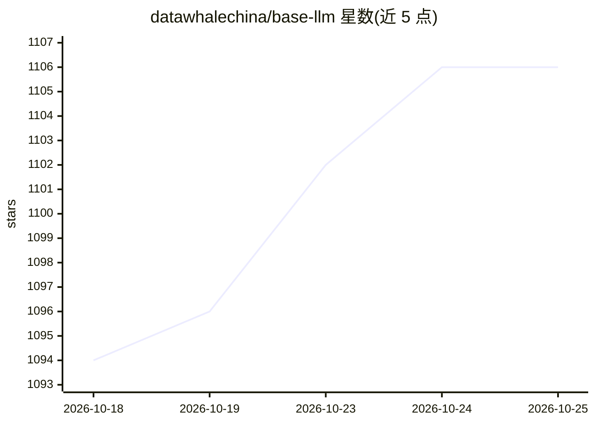

# datawhalechina/base-llm

⭐ 1,107 · Jupyter Notebook · 推送 2026-09-30 · [GitHub](https://github.com/datawhalechina/base-llm) · [官网](https://datawhalechina.github.io/base-llm/) · 组织维护 · 中文 README

**面向开发者的 NLP 到 LLM 全栈中文学习教程**

Datawhale 组织维护的算法教程项目，内容按理论篇、实战篇、微调量化篇、应用部署篇、大模型安全、多模态前沿及番外篇组织：从分词、词向量、RNN/LSTM 讲到 Transformer、BERT/GPT/T5，含手写 Llama2、PEFT/LoRA 微调 Qwen2.5、RLHF/DPO、量化、FastAPI 与 Docker Compose 部署等实战章节。要求读者具备 Python、PyTorch 与深度学习基础。提供 GitHub Pages 在线阅读，采用 CC BY-NC-SA 4.0 许可。

## 筛选速览

| 维度 | 判定 | 备注 |
|---|---|---|
| AI 角色 | `ai-knowledge` | 知识聚合/清单类 |
| 许可风险 | `none` | — |
| 部署形态 | `self-host` | docker 或自建部署 |
| 模型依赖 | — | README 未给出锁定关系 |
| 硬件要求 | — | 无带数字的原话,不猜 |
| 安装摩擦 | `low` | 无编译、无系统依赖或容器化 |
| 成熟度 | `idea` | |

## 能力要点

- 从词向量到 Transformer、BERT/GPT/Llama 的体系化教程结构
- 手写 Llama2 与 Transformer 核心架构代码的教学模式
- 包含文本分类、NER、LoRA 微调 Qwen2.5 等完整实战项目
- 覆盖 FastAPI、Docker Compose、Jenkins CI/CD 部署流程

## 适用场景

- 系统学习从 NLP 基础到 LLM 微调部署的全栈路径
- 寻找 NER、文本分类等任务的基线代码实现
- 了解大模型量化、RLHF 与服务化部署的工程实践

## 场景标签

`教程课程` · 领域:学习与行业

## 证据(README 行号)

> L28: 本项目是一个**从传统自然语言处理（NLP）到大语言模型（LLM）的全栈式学习教程**，旨在为开发者提供一条从理论入门到工程实战的清晰路径。
> L30: 在 LLM 爆发的今天，许多开发者直接上手调用 API 或微调大模型，却往往忽视了底层的自然语言处理（NLP）基础。本项目主张 **“Base LLM is all you need”**，通过系统性地回顾 NLP 发展历程中的核

## 星数曲线

2026-10-18 1,094 → 2026-10-25 1,106（+12）

---
*卡片 v1 · prompt 1.4 · 生成 2026-10-22 · 置信度 mid · 依据 README sha `b113b188acff` · [字段定义](../../DATASET.md)*
