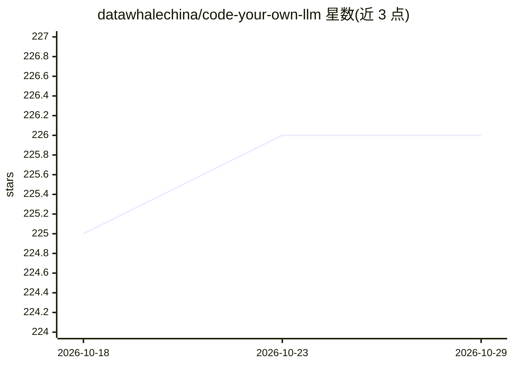

# datawhalechina/code-your-own-llm

⭐ 226 · NOASSERTION · 推送 2026-01-15 · [GitHub](https://github.com/datawhalechina/code-your-own-llm) · 组织维护 · 中文 README

**从零训练大语言模型的全栈式教学参考指南**

基于 nanochat 深度扩展的开源教程项目，以扁平化、零嵌套的极简代码端到端演示大语言模型从零训练到工程落地的流程。内容覆盖环境配置、数据、分词、模型架构、预训练、微调、强化学习对齐、推理、评估与红队测试共 12 章，辅以算法原理讲解与可视化交互，部分章节仍在建设中。面向希望理解模型训练每个细节的学习者，采用 CC BY-NC-SA 4.0 许可。

## 筛选速览

| 维度 | 判定 | 备注 |
|---|---|---|
| AI 角色 | `ai-knowledge` | 知识聚合/清单类 |
| 许可风险 | `none` | NOASSERTION |
| 部署形态 | `None` |  |
| 模型依赖 | — | README 未给出锁定关系 |
| 硬件要求 | — | 无带数字的原话,不猜 |
| 安装摩擦 | `low` | 无编译、无系统依赖或容器化 |
| 成熟度 | `idea` | |

## 能力要点

- 基于 nanochat 的极简扁平化代码实现
- 覆盖预训练/微调/强化学习/评估/安全共 12 章
- 提供原理讲解、复现教程与可视化交互
- 部分章节标注建设中（🚧）

## 适用场景

- 系统学习大语言模型从零训练到落地的完整流程
- 理解每行代码背后的数学原理与工程考量
- 按需调整模型架构与训练策略的实践参考

## 场景标签

`教程课程` `模型训练` `微调` `强化学习` · 领域:学习与行业

## 证据(README 行号)

> L4:  这是一份全栈式的参考指南，用最简洁的代码帮助你端到端定义大语言模型的每一个细节
> L12: **Code Your Own LLM** 是一个基于 nanochat 的深度扩展项目，旨在提供一份从原理到实践、从算法到工程的全栈式大语言模型参考指南。我们将提供最简洁的代码实现，没有复杂封装、层层继承和不必要的抽象，用极致的

## 星数曲线

2026-10-18 225 → 2026-10-29 226（+1）

---
*卡片 v1 · prompt 1.4 · 生成 2026-10-23 · 置信度 high · 依据 README sha `97b5a9f6f2d4` · [字段定义](../../DATASET.md)*
