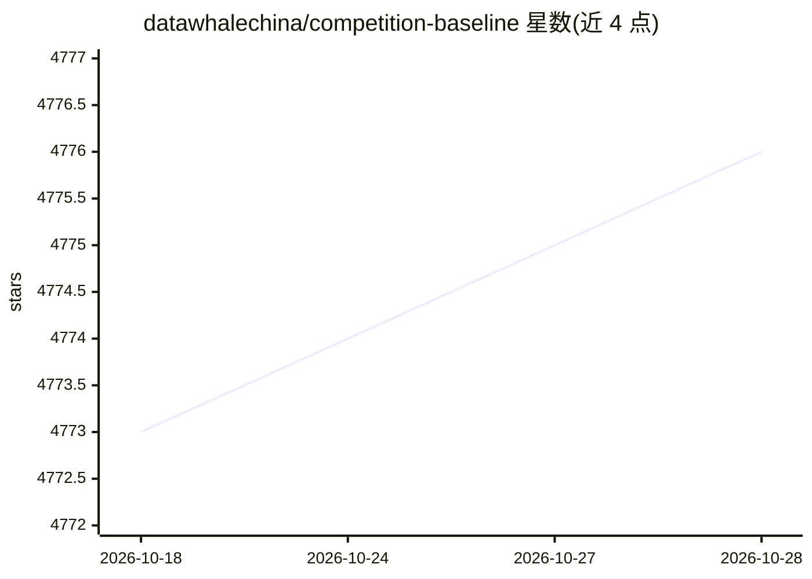

# datawhalechina/competition-baseline

⭐ 4,776 · Jupyter Notebook · GPL-3.0 · 推送 2026-07-22 · [GitHub](https://github.com/datawhalechina/competition-baseline) · [官网](http://coggle.club/) · 组织维护 · 中文 README

**数据竞赛 baseline 方案合集：面向竞赛初学者整理代码与思路**

由 Datawhale 维护的数据竞赛方案聚合仓库：按比赛收录 baseline 代码与解题思路，覆盖结构化数据挖掘、计算机视觉、自然语言处理等类型，涉及科大讯飞AI开发者大赛、天池、DataFountain、Kaggle、腾讯广告算法大赛等赛事，并链接部分优胜者开源代码。仓库给出贡献规范：代码需注明比赛网址、数据类型与运行环境，且只提供可运行代码和思路、不提供可直接提交的结果文件。提供 Gitee 国内备份访问地址。

## 筛选速览

| 维度 | 判定 | 备注 |
|---|---|---|
| AI 角色 | `ai-knowledge` | 知识聚合/清单类 |
| 许可风险 | `viral` | GPL-3.0 |
| 部署形态 | `None` |  |
| 模型依赖 | — | README 未给出锁定关系 |
| 硬件要求 | — | 无带数字的原话,不猜 |
| 安装摩擦 | `low` | 无编译、无系统依赖或容器化 |
| 成熟度 | — | 结构信号不足 |

## 能力要点

- 按赛事与任务类型（结构化/CV/NLP等）组织的 baseline 汇总
- 覆盖科大讯飞、天池、DataFountain、Kaggle 等多项赛事
- 部分条目附带成绩指标与优胜者开源代码链接
- 提供 Gitee 国内备份仓库

## 适用场景

- 作为竞赛初学者查找某类数据问题的入门方法与代码
- 了解历届各赛事赛题设置与解题思路
- 查找部分比赛的优胜方案开源代码入口

## 场景标签

`精选清单` · 领域:学习与行业

## 证据(README 行号)

> L3: 假如你是数据竞赛的初学者、爱好者，比赛的baseline不仅是比赛思路分享，同时也是一类数据问题的方法总结。本Repo想做的就是将收集并整理并分享各种比赛的baseline方案。
> L15: ## 竞赛分享

## 星数曲线

2026-10-18 4,773 → 2026-10-28 4,776（+3）

---
*卡片 v1 · prompt 1.4 · 生成 2026-10-20 · 置信度 high · 依据 README sha `825febc8cc9e` · [字段定义](../../DATASET.md)*
