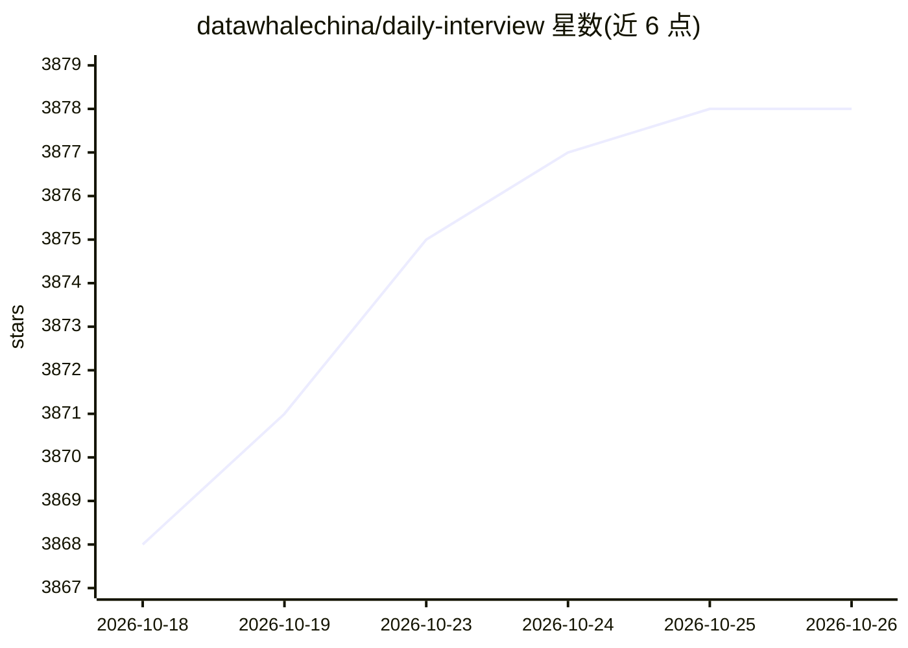

# datawhalechina/daily-interview

⭐ 3,878 · GPL-3.0 · 推送 2026-07-08 · [GitHub](https://github.com/datawhalechina/daily-interview) · [官网](https://datawhalechina.github.io/daily-interview/) · 组织维护 · 中文 README

**Datawhale 维护的技术面试高频知识点面经合集**

面向求职者的面试复习资料库，按算法基础、编程语言、计算机基础、AI算法、系统设计、开发技术、项目经验、行为面试 8 个模块组织内容，覆盖机器学习、NLP、CV 等方向，2025-07 新增大语言模型面试资料。以在线文档站点形式提供阅读，基于 VitePress 构建并支持本地中文搜索与 LaTeX 公式渲染；明确声明只收录高频考点、提供思路而非标准答案，采用 CC BY-NC-SA 4.0 许可，禁止商业使用。

## 筛选速览

| 维度 | 判定 | 备注 |
|---|---|---|
| AI 角色 | `ai-knowledge` | 知识聚合/清单类 |
| 许可风险 | `viral` | GPL-3.0 |
| 部署形态 | `None` |  |
| 模型依赖 | — | README 未给出锁定关系 |
| 硬件要求 | — | 无带数字的原话,不猜 |
| 安装摩擦 | `low` | 无编译、无系统依赖或容器化 |
| 成熟度 | — | 结构信号不足 |

## 能力要点

- 8 个知识模块覆盖算法、AI、开发、系统设计与行为面试
- 在线阅读站点，VitePress 构建，支持本地中文搜索与 LaTeX 渲染
- 按算法岗/开发岗给出重点模块与复习时间建议
- 2025-07 新增大语言模型相关面试资料

## 适用场景

- 面试前 1-2 天按岗位快速复习高频考点
- 算法岗求职者集中复习机器学习、深度学习、NLP、CV 题目
- 准备项目介绍与行为面试的表达模板

## 场景标签

`教程课程` · 领域:学习与行业

## 证据(README 行号)

> L9: **每一个面试者面试之前必看一遍的小面经**
> L44: |🤖 **AI算法**|机器学习、深度学习、NLP、CV|算法岗、AI工程师|

## 星数曲线

2026-10-18 3,868 → 2026-10-26 3,878（+10）

---
*卡片 v1 · prompt 1.4 · 生成 2026-10-20 · 置信度 high · 依据 README sha `9a4cfae6f3db` · [字段定义](../../DATASET.md)*
