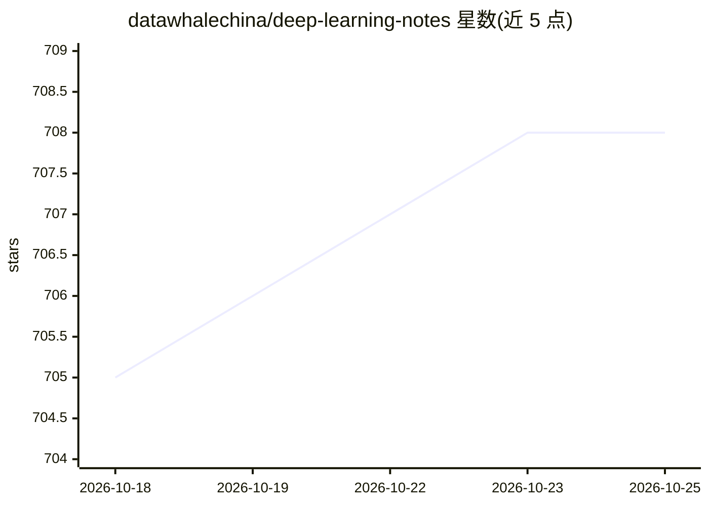

# datawhalechina/deep-learning-notes

⭐ 708 · Python · NOASSERTION · 推送 2026-10-24 · [GitHub](https://github.com/datawhalechina/deep-learning-notes) · [官网](https://datawhalechina.github.io/deep-learning-notes/) · 个人维护 · 中文 README

**个人深度学习自学笔记教程：从神经网络基础到 LLM 工程与推理**

以 Quarto Markdown 编写并构建为静态网站的个人深度学习学习笔记，内容从神经网络基础、PyTorch、CNN/RNN 讲到 Attention、Transformer、从零实现 GPT-2，再延伸到 LLM 训练工程、数据处理、scaling laws、模型评估、后训练，以及 vLLM 与 SGLang 等推理框架。作者声明 LLM 辅助写作并自行审校。配套 Jupyter Notebook 版本可在 Google Colab 打开，运行示例需安装自维护的 dnnlpy 库（MIT），笔记正文采用 CC BY-NC 4.0 许可。

## 筛选速览

| 维度 | 判定 | 备注 |
|---|---|---|
| AI 角色 | `ai-knowledge` | 知识聚合/清单类 |
| 许可风险 | `none` | NOASSERTION |
| 部署形态 | `library` | 以包/库形式分发 |
| 模型依赖 | — | README 未给出锁定关系 |
| 硬件要求 | — | 无带数字的原话,不猜 |
| 安装摩擦 | `low` | 无编译、无系统依赖或容器化 |
| 成熟度 | — | 结构信号不足 |

## 能力要点

- 覆盖从神经网络基础到 LLM 训练工程、评估与 vLLM/SGLang 推理优化的内容体系
- Quarto Markdown 编写并构建为静态网站，可用 quarto convert 生成 Notebook
- 配套 Notebook 可在 Google Colab 直接打开，与主仓库同步
- 示例代码在 Python 3.14 / PyTorch 2.14 / Transformers v5 环境下测试

## 适用场景

- 自学深度学习并系统衔接传统内容与大模型方向
- 在 Colab 中直接运行配套 Notebook 练习
- 作为可版本控制、持续更新的学习参考资料

## 场景标签

`教程课程` · 领域:学习与行业

## 证据(README 行号)

> L17: So I decided to gradually organize what I encounter during my own learning process. These notes start with the basi
> L28: The content mainly includes:
> L30: - Neural network fundamentals, PyTorch, MLPs, and optimization algorithms

## 星数曲线

2026-10-18 705 → 2026-10-25 708（+3）

---
*卡片 v1 · prompt 1.4 · 生成 2026-10-21 · 置信度 mid · 依据 README sha `18770b6718ec` · [字段定义](../../DATASET.md)*
