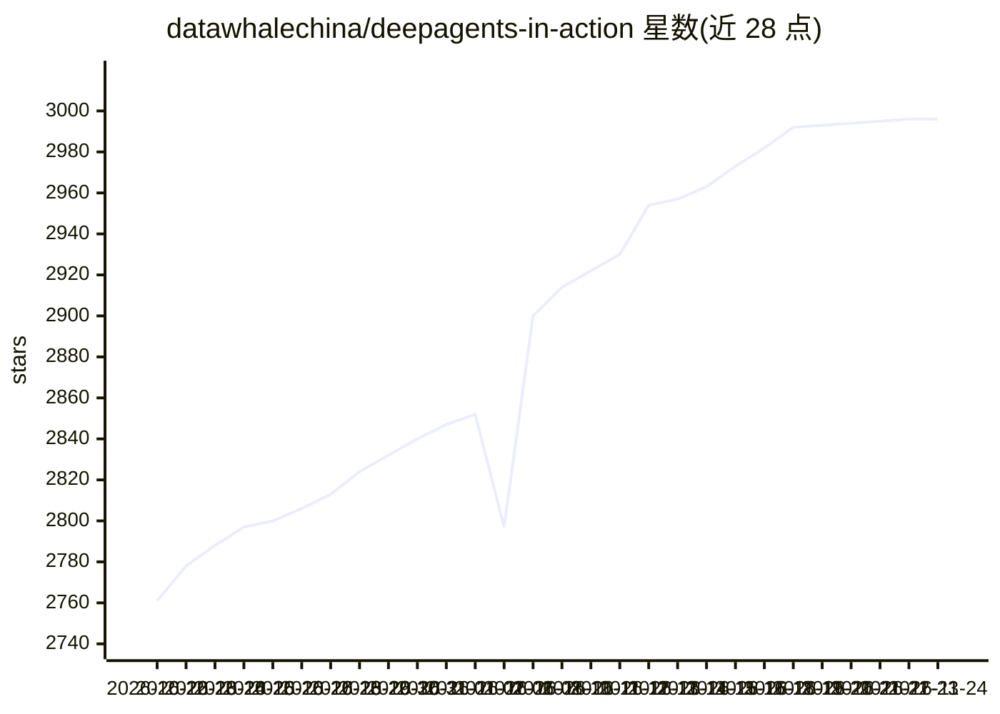

# datawhalechina/deepagents-in-action

⭐ 2,997 · Jupyter Notebook · 推送 2026-11-17 · [GitHub](https://github.com/datawhalechina/deepagents-in-action) · [官网](https://datawhalechina.github.io/deepagents-in-action/) · 组织维护 · 中文 README

**基于 LangChain/LangGraph 构建生产级 AI Agent 的中文开源课程**

DataWhale 上的中文开源教程，17 章图文与实验模板，配套 AgentSeek 工程化套件创建各章模板并运行实验，覆盖任务规划、虚拟文件系统、子 Agent 协作、上下文管理、MCP、沙箱执行与流式事件等主题；课程围绕 Deep Agents 0.7.x 版本，各章节标注依赖版本要求，示例默认通过硅基流动接入支持工具调用的模型。课程内容采用 CC BY-NC-SA 4.0，网站源码为 MIT。

## 筛选速览

| 维度 | 判定 | 备注 |
|---|---|---|
| AI 角色 | `ai-knowledge` | 知识聚合/清单类 |
| 许可风险 | `none` | — |
| 部署形态 | `library` | 以包/库形式分发 |
| 模型依赖 | — | README 未给出锁定关系 |
| 硬件要求 | — | 无带数字的原话,不猜 |
| 安装摩擦 | `low` | 无编译、无系统依赖或容器化 |
| 成熟度 | — | 结构信号不足 |

## 能力要点

- 17 章图文与实验模板，按认知/核心/进阶/前沿预览组织
- 通过 AgentSeek CLI 创建各章专属模板并检查环境、启动应用
- 配套 LangChain 开发指南与 LangSmith Trace 调试两个 AI 编码助手技能
- 标注各功能对应的 deepagents 版本要求与迁移指南

## 适用场景

- 系统学习 Deep Agents/LangChain/LangGraph 的 Agent 开发
- 按章节模板动手复现任务规划、子 Agent 与沙箱实验
- 从 Deep Agents 0.5/0.6 升级到 0.7 时参考迁移说明

## 场景标签

`教程课程` · 领域:学习与行业

## 证据(README 行号)

> L4:  Deep Agents 实战 — 基于 LangChain / LangGraph 的中文开源课程，感谢 2,000+ GitHub Stars
> L20: 基于 LangChain / LangGraph 的中文开源课程，配套 **17 章图文与实验模板，并持续补充视频**。从第一个 Agent 开始，逐步掌握任务规划、文件系统、子 Agent 协作与上下文管理。

## 星数曲线

2026-10-22 2,761 → 2026-11-24 2,996（+235）

---
*卡片 v1 · prompt 1.4 · 生成 2026-11-23 · 置信度 high · 依据 README sha `cfa07c87d73e` · [字段定义](../../DATASET.md)*
