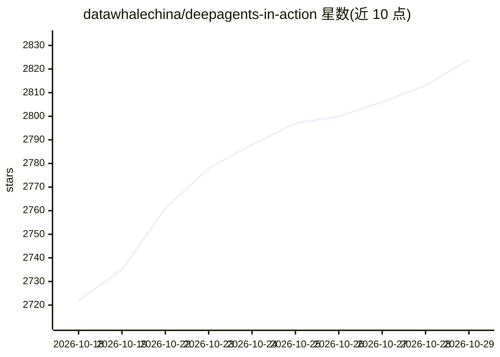

# datawhalechina/deepagents-in-action

⭐ 2,824 · Jupyter Notebook · 推送 2026-10-27 · [GitHub](https://github.com/datawhalechina/deepagents-in-action) · [官网](https://datawhalechina.github.io/deepagents-in-action/) · 组织维护 · 中文 README

**中文开源课程：基于 LangChain/LangGraph 从零构建生产级 AI Agent**

由 DataWhale 组织、LangChain 官方认证大使沧海九粟编写的中文课程，配套 16 章图文、B 站视频与实验模板，覆盖任务规划、虚拟文件系统、子 Agent 协作、长期记忆、MCP、沙箱执行等主题。基于 AgentSeek 套件创建实验模板（uv/npm 安装、agentseek 命令启动），示例默认通过硅基流动接入模型，用 MODEL_NAME 环境变量配置。网站以 Astro 构建，内容 CC BY-NC-SA 4.0、源码 MIT 双协议发布。

## 筛选速览

| 维度 | 判定 | 备注 |
|---|---|---|
| AI 角色 | `ai-knowledge` | 知识聚合/清单类 |
| 许可风险 | `none` | — |
| 部署形态 | `library` | 以包/库形式分发 |
| 模型依赖 | — | README 未给出锁定关系 |
| 硬件要求 | — | 无带数字的原话,不猜 |
| 安装摩擦 | `low` | 无编译、无系统依赖或容器化 |
| 成熟度 | — | 结构信号不足 |

## 能力要点

- 16 章课程配套每章实验模板（agentseek create 创建）
- 跟踪 Deep Agents v0.7 版本变化并给出迁移说明
- 示例默认接入硅基流动模型服务，含新用户代金券与实验配额补贴池
- Astro 静态站点 + Markdown 内容流水线构建

## 适用场景

- 系统学习用 Deep Agents/LangGraph 构建生产级 Agent
- 按章节模板动手复现子 Agent、MCP、沙箱等实验
- 了解 Deep Agents v0.5→v0.7 的行为变化与迁移路径

## 场景标签

`教程课程` · 领域:学习与行业

## 证据(README 行号)

> L17: 基于 LangChain / LangGraph 的中文开源课程，配套 **16 章图文、视频与实验模板**。从第一个 Agent 开始，逐步掌握任务规划、文件系统、子 Agent 协作与上下文管理。
> L39: ## 课程大纲
> L41: **想先看 Deep Agents 的整体架构？** 第 1 章的三层选择与组合解释 Deep Agents、LangChain 与 LangGraph 的分工；整体架构图展示 Middleware、工具、Backend 和运行时

## 星数曲线

2026-10-18 2,722 → 2026-10-29 2,824（+102）

---
*卡片 v1 · prompt 1.4 · 生成 2026-10-21 · 置信度 high · 依据 README sha `b3ba35f51efc` · [字段定义](../../DATASET.md)*
