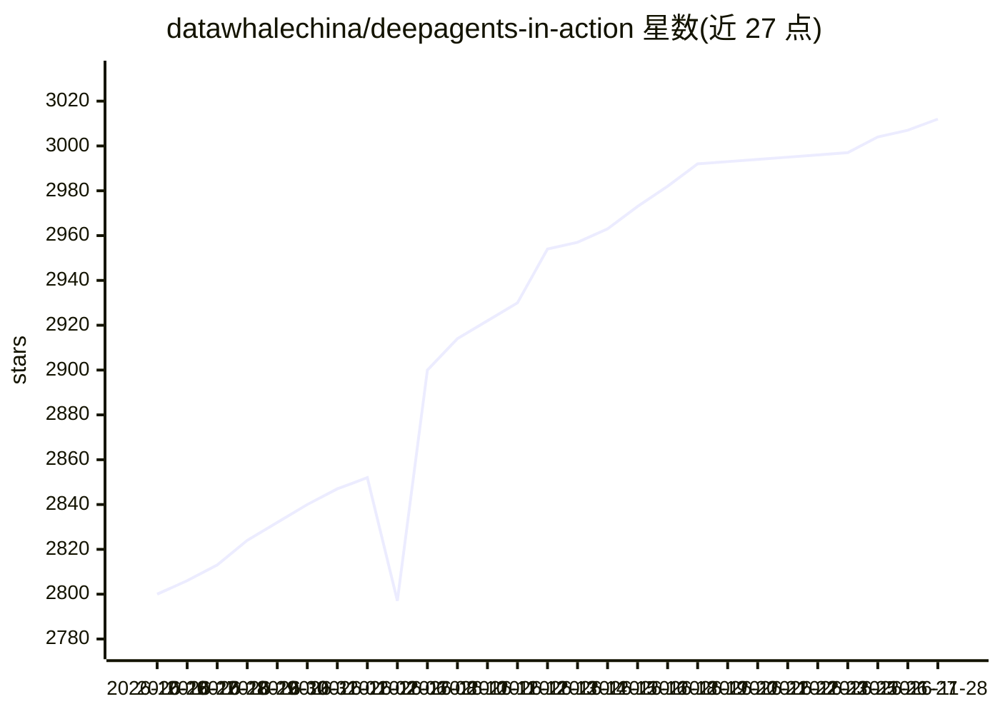

# datawhalechina/deepagents-in-action

⭐ 3,012 · Jupyter Notebook · 推送 2026-11-24 · [GitHub](https://github.com/datawhalechina/deepagents-in-action) · [官网](https://datawhalechina.github.io/deepagents-in-action/) · 组织维护 · 中文 README

**基于 LangChain/LangGraph 构建生产级 AI Agent 的中文开源课程**

DataWhale 组织的中文开源课程，包含 17 章图文与实验模板并持续补充视频，覆盖任务规划、虚拟文件系统、子 Agent 协作、上下文管理、沙箱执行、MCP、Human-in-the-Loop 等 Deep Agents 能力。示例通过硅基流动接入支持工具调用的模型，用 agentseek CLI 创建与启动各章实验模板，课程基于 Deep Agents 0.7.x 并附版本迁移指南。网站以 Astro 构建，课程内容采用 CC BY-NC-SA 4.0，源代码 MIT。

## 筛选速览

| 维度 | 判定 | 备注 |
|---|---|---|
| AI 角色 | `ai-knowledge` | 知识聚合/清单类 |
| 许可风险 | `none` | — |
| 部署形态 | `library` | 以包/库形式分发 |
| 模型依赖 | — | README 未给出锁定关系 |
| 硬件要求 | — | 无带数字的原话,不猜 |
| 安装摩擦 | `low` | 无编译、无系统依赖或容器化 |
| 成熟度 | — | 结构信号不足 |

## 能力要点

- 17 章图文与实验模板，覆盖 Deep Agents 0.7.x 全部核心功能
- agentseek CLI 创建模板、检查环境并启动实验
- 示例默认通过硅基流动接入支持工具调用的模型
- 提供配套 AI 编码助手技能（langchain-dev-guide、langsmith-trace）

## 适用场景

- 从零学习用 LangChain/LangGraph 构建 Deep Agents
- 按章节实验掌握子 Agent 编排与上下文管理
- 从 Deep Agents 0.5/0.6 迁移到 0.7 的开发者参考

## 场景标签

`教程课程` · 领域:学习与行业

## 证据(README 行号)

> L4:  Deep Agents 实战 — 基于 LangChain / LangGraph 的中文开源课程，庆祝 GitHub 3,000 Stars，感谢每一位学习者与贡献者
> L20: 基于 LangChain / LangGraph 的中文开源课程，配套 **17 章图文与实验模板，并持续补充视频**。从第一个 Agent 开始，逐步掌握任务规划、文件系统、子 Agent 协作与上下文管理。
> L43: ## 课程大纲

## 星数曲线

2026-10-26 2,800 → 2026-11-28 3,012（+212）

---
*卡片 v1 · prompt 1.4 · 生成 2026-11-26 · 置信度 high · 依据 README sha `fbab6e3370ce` · [字段定义](../../DATASET.md)*
