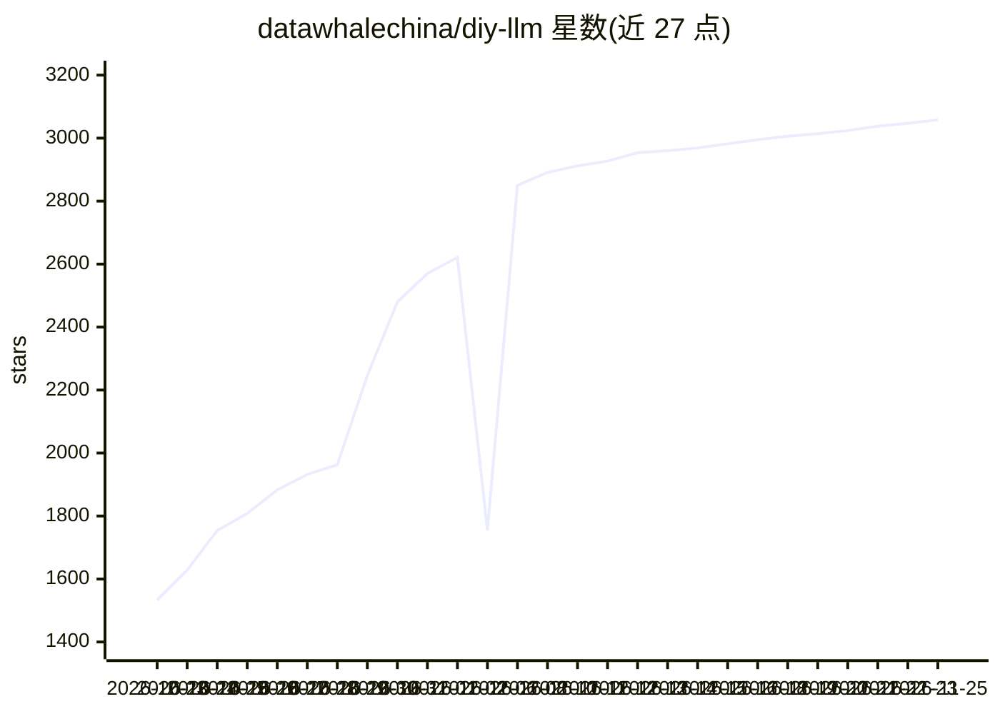

# datawhalechina/diy-llm

⭐ 3,058 · Jupyter Notebook · 推送 2026-11-23 · [GitHub](https://github.com/datawhalechina/diy-llm) · [官网](https://datawhalechina.github.io/diy-llm/) · 组织维护 · 中文 README

**中文学习者从零构建 LLM 的全栈教程与 6 项代码作业**

基于 Stanford CS336 的社区中文学习项目，提供 16 章讲义与 6 个渐进式代码作业，覆盖分词器、Transformer、MoE、GPU 编程、分布式训练、Scaling Laws、推理、数据工程、SFT/RLHF/GRPO 对齐、评估与多模态。按中文学习者习惯重排知识体系，补齐前置知识，加入 Qwen、DeepSeek 等国产模型案例与 C-EVAL 评测，作业提供可运行实现并适配 CPU/Mac 调试。提供在线阅读、PDF 讲义与作业代码仓库，采用 CC BY-NC-SA 4.0 许可。

## 筛选速览

| 维度 | 判定 | 备注 |
|---|---|---|
| AI 角色 | `ai-knowledge` | 知识聚合/清单类 |
| 许可风险 | `none` | — |
| 部署形态 | `None` |  |
| 模型依赖 | — | README 未给出锁定关系 |
| 硬件要求 | — | 无带数字的原话,不猜 |
| 安装摩擦 | `medium` | 含编译或系统依赖之一 |
| 成熟度 | — | 结构信号不足 |

## 能力要点

- 16 章中文讲义 + 6 个可运行代码作业，覆盖 LLM 全栈链路
- 基于 Stanford CS336 2025/2026 版本，补充本土化案例与前置知识
- 作业覆盖手写 tokenizer、Triton 实现 FlashAttention-2、分布式训练、GRPO 对齐与多维度评测
- 提供在线文档、离线 PDF 讲义与云算力方案

## 适用场景

- 系统学习大模型从预训练到对齐的完整工程流程
- 跟随作业动手实现 tokenizer、模型架构、分布式训练与对齐训练
- 在中文语境下阅读含 Qwen/DeepSeek 案例的 LLM 课程讲义

## 场景标签

`教程课程` `模型训练` `强化学习` · 领域:学习与行业

## 证据(README 行号)

> L17:  从分词器、数据与训练，到系统优化、推理、对齐、评估与多模态，把构建 LLM 的整条链路连成一套知识体系。
> L27: 目前课程包含 **16 章正文 + 6 个配套作业**，由 3 位项目负责人统筹、多位社区贡献者参与，并持续接受勘误与修订（名单见下方「贡献者」）。
> L27: 目前课程包含 **16 章正文 + 6 个配套作业**，由 3 位项目负责人统筹、多位社区贡献者参与，并持续接受勘误与修订（名单见下方「贡献者」）。

## 星数曲线

2026-10-23 1,533 → 2026-11-25 3,058（+1,525）

---
*卡片 v1 · prompt 1.4 · 生成 2026-11-24 · 置信度 high · 依据 README sha `fed5f78bb0ac` · [字段定义](../../DATASET.md)*
