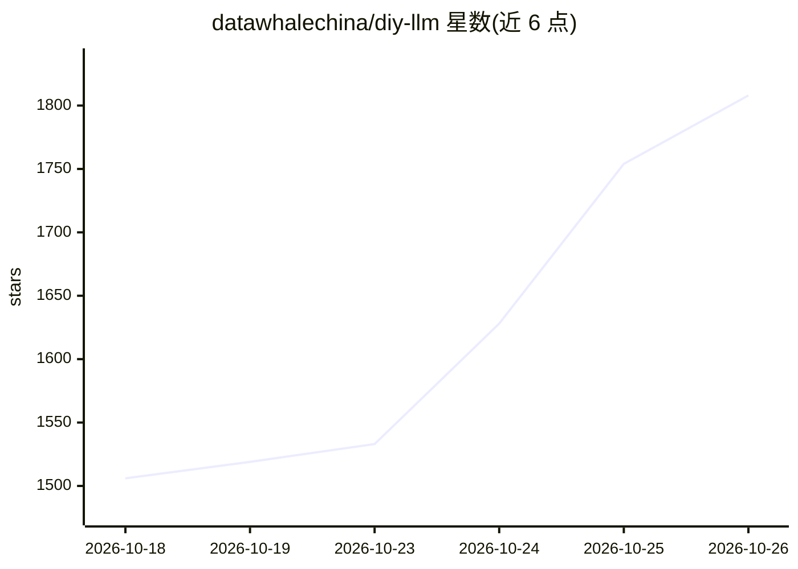

# datawhalechina/diy-llm

⭐ 1,808 · Jupyter Notebook · 推送 2026-10-09 · [GitHub](https://github.com/datawhalechina/diy-llm) · [官网](https://datawhalechina.github.io/diy-llm/) · 组织维护 · 中文 README

**面向中文学习者的 LLM 全栈中文课程（CS336 中文版，6 项代码作业）**

Datawhale 维护的中文开源课程，基于 Stanford CS336 内容做本土化重构：覆盖分词器、Transformer 架构、MoE、GPU 高性能编程（CUDA/Triton）、分布式训练、Scaling Laws、推理优化、数据工程、对齐（SFT/DPO/GRPO）等 16 章，配 6 项渐进代码作业（含手搓大模型、Triton 实现 FlashAttention-2、预训练数据处理等）。以在线文档、PDF 讲义与 coursework 作业形式提供，完整训练需 GPU，理论部分可 CPU 学习。采用 CC BY-NC-SA 4.0 许可。

## 筛选速览

| 维度 | 判定 | 备注 |
|---|---|---|
| AI 角色 | `ai-knowledge` | 知识聚合/清单类 |
| 许可风险 | `none` | — |
| 部署形态 | `None` |  |
| 模型依赖 | — | README 未给出锁定关系 |
| 硬件要求 | — | 无带数字的原话,不猜 |
| 安装摩擦 | `medium` | 含编译或系统依赖之一 |
| 成熟度 | — | 结构信号不足 |

## 能力要点

- 16 章覆盖预训练数据到推理与对齐的 LLM 全流程
- 6 项代码作业：手搓大模型、Triton 实现 FlashAttention-2、Scaling Law 拟合、SFT/GRPO 对齐等
- 提供中英双语文档与 PDF 讲义下载
- 包含 Qwen、DeepSeek 等国产模型案例

## 适用场景

- 系统学习从数据处理到对齐的 LLM 构建全流程
- 通过手写代码理解 tokenizer、Transformer、MoE 等组件
- 结合 GPU/分布式训练作业积累工程经验

## 场景标签

`教程课程` · 领域:学习与行业

## 证据(README 行号)

> L16: 我们希望这门 CS336 中文课程，不只是斯坦福原版的"汉化版"，而是一座为中文学习者量身打造的"LLM炼丹工坊"。在这里，你亲手锻造理解、打磨代码、调控火候，最终炼出属于自己的大模型真丹。
> L48: |第2章 分词器|BPE 算法原理、Unicode 规范化、手写 tokenizer 训练代码|作业1|✅|

## 星数曲线

2026-10-18 1,506 → 2026-10-26 1,808（+302）

---
*卡片 v1 · prompt 1.4 · 生成 2026-10-22 · 置信度 high · 依据 README sha `f2d7e47e9d20` · [字段定义](../../DATASET.md)*
