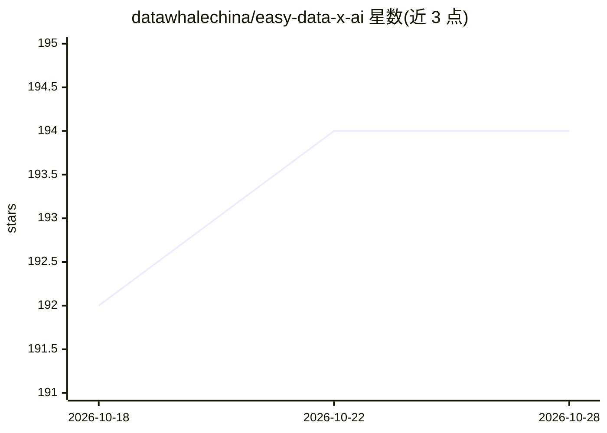

# datawhalechina/easy-data-x-ai

⭐ 194 · Python · NOASSERTION · 推送 2026-10-08 · [GitHub](https://github.com/datawhalechina/easy-data-x-ai) · [官网](https://datawhalechina.github.io/easy-data-x-ai/) · 组织维护 · 中文 README

**面向 AI 爱好者的 Data x AI 入门课程，双轨学习构建 Agent**

DataWhale 出品的开源教程课程，分道篇（面向零基础爱好者与产品决策者，讲场景判断、三层度量框架、RAG/MCP/Skill/Memory 设计哲学）、术篇（面向已能调用 LLM API 的开发者，实战数据层搭建、Agentic RAG、记忆系统）与产业应用篇（AI 原生数据库、上下文工程等），另附扩展章节。支持在线阅读、git clone 本地阅读与 Python 3.11 虚拟环境运行示例代码；模型算力由阿里云百炼与硅基流动提供赞助，当前为 Alpha 内测版。

## 筛选速览

| 维度 | 判定 | 备注 |
|---|---|---|
| AI 角色 | `ai-knowledge` | 知识聚合/清单类 |
| 许可风险 | `none` | NOASSERTION |
| 部署形态 | `library` | 以包/库形式分发 |
| 模型依赖 | — | README 未给出锁定关系 |
| 硬件要求 | — | 无带数字的原话,不猜 |
| 安装摩擦 | `low` | 无编译、无系统依赖或容器化 |
| 成熟度 | `idea` | |

## 能力要点

- 道/术/产业三篇分轨课程结构，覆盖产品视角与工程实战
- 术篇含 AI Native 数据层、Agentic RAG、Agent 记忆系统开发实战
- 产业篇覆盖 AI 原生数据库、向量数据库与 RAG、上下文工程等 8 个已完成章节
- 示例代码读取 .env 配置，支持本地 Python 虚拟环境运行

## 适用场景

- 零基础爱好者系统学习 Agent 与数据基础知识
- 开发者动手搭建 Agentic RAG 与 Agent 记忆系统
- 产品决策者学习评估 Agent 场景可行性与度量框架

## 场景标签

`教程课程` · 领域:学习与行业

## 证据(README 行号)

> L5:  面向所有 AI 爱好者的 Data 与 AI 基础知识入门教程
> L46: ## 📖 课程目录

## 星数曲线

2026-10-18 192 → 2026-10-28 194（+2）

---
*卡片 v1 · prompt 1.4 · 生成 2026-10-22 · 置信度 mid · 依据 README sha `08416762985b` · [字段定义](../../DATASET.md)*
