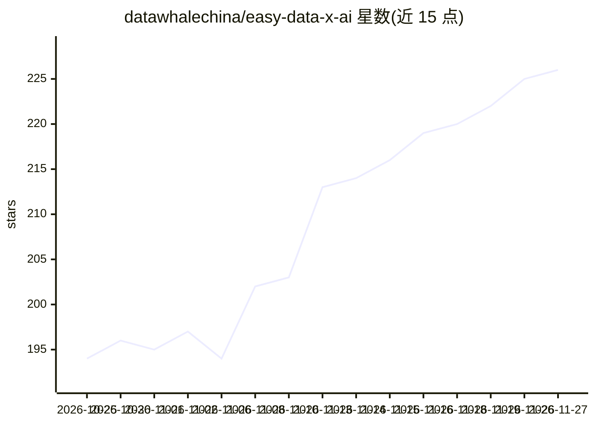

# datawhalechina/easy-data-x-ai

⭐ 226 · Python · NOASSERTION · 推送 2026-11-06 · [GitHub](https://github.com/datawhalechina/easy-data-x-ai) · [官网](https://datawhalechina.github.io/easy-data-x-ai/) · 组织维护 · 中文 README

**面向 AI 爱好者的数据与 AI 基础入门教程**

Datawhale 出品的中文开源课程，从数据驱动视角学习构建 AI Agent，设三轨：道篇面向零基础爱好者与产品决策者讲场景判断、归因度量与设计哲学；术篇面向已能调用 LLM API 的开发者讲流式输出、工具调用、AI Native 数据层、Agentic RAG 与记忆系统；产业应用篇覆盖 AI 原生数据库、向量检索、上下文工程等 8 章。支持在线阅读与本地克隆运行示例（Python 3.11 虚拟环境），采用知识共享 BY-NC-SA 4.0 许可。

## 筛选速览

| 维度 | 判定 | 备注 |
|---|---|---|
| AI 角色 | `ai-knowledge` | 知识聚合/清单类 |
| 许可风险 | `none` | NOASSERTION |
| 部署形态 | `library` | 以包/库形式分发 |
| 模型依赖 | — | README 未给出锁定关系 |
| 硬件要求 | — | 无带数字的原话,不猜 |
| 安装摩擦 | `low` | 无编译、无系统依赖或容器化 |
| 成熟度 | `idea` | |

## 能力要点

- 道篇/术篇/产业应用篇/扩展章节四类共 20 门课程内容
- 术篇提供可运行的工程实战（流式输出、工具调用、RAG、记忆系统）
- 模型算力由阿里云百炼与 SiliconFlow 提供支持
- 支持在线阅读与本地 git clone 运行示例

## 适用场景

- 零基础学习 AI Agent 的场景判断与产品设计
- 动手搭建 Agent 的数据层、记忆系统与技能调用
- 了解 AI 原生数据库与上下文工程的产业实践

## 场景标签

`教程课程` · 领域:学习与行业

## 证据(README 行号)

> L5:  面向所有 AI 爱好者的 Data 与 AI 基础知识入门教程
> L16: 为了满足不同角色的学习需求，我们将课程精心设计为两条路径："道篇"与"术篇"。
> L27: ### 术篇：用其术（开发者的"功法篇"）

## 星数曲线

2026-10-25 194 → 2026-11-27 226（+32）

---
*卡片 v1 · prompt 1.4 · 生成 2026-11-25 · 置信度 high · 依据 README sha `f927d53136f4` · [字段定义](../../DATASET.md)*
