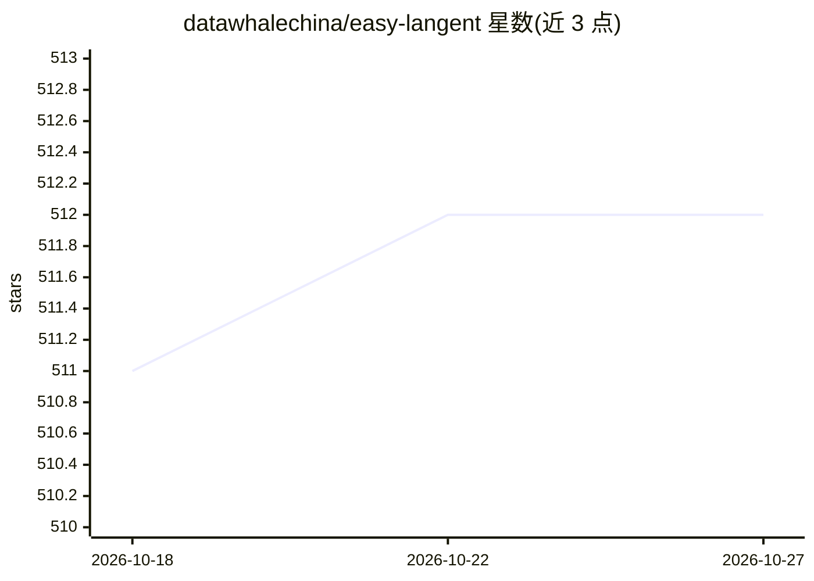

# datawhalechina/easy-langent

⭐ 512 · Python · Apache-2.0 · 推送 2026-09-09 · [GitHub](https://github.com/datawhalechina/easy-langent) · [官网](https://datawhalechina.github.io/easy-langent/) · 组织维护 · 中文 README

**LangChain/LangGraph 智能体开发中文学习教程**

由 Datawhale 维护的智能体开发学习教程，覆盖 LangChain 框架认知、核心组件实操（模型调用、提示词模板、记忆、工具）、RAG 应用、LangGraph 有状态工作流与多智能体协作，以综合实战项目收尾。每章配套实操任务，面向有 Python 基础、了解大模型概念的高校学生与开发者；另收录内测与组队学习的学员实战项目（如狼人杀、医疗 RAG 诊断等）。提供 GitHub Pages 与国内镜像在线阅读，内容采用 CC BY-NC-SA 4.0 许可。

## 筛选速览

| 维度 | 判定 | 备注 |
|---|---|---|
| AI 角色 | `ai-knowledge` | 知识聚合/清单类 |
| 许可风险 | `permissive` | Apache-2.0 |
| 部署形态 | `None` |  |
| 模型依赖 | — | README 未给出锁定关系 |
| 硬件要求 | — | 无带数字的原话,不猜 |
| 安装摩擦 | `low` | 无编译、无系统依赖或容器化 |
| 成熟度 | — | 结构信号不足 |

## 能力要点

- 从框架认知到多智能体协作的循序渐进教程大纲
- 每章配套实操任务，强调动手实践
- 收录十余个学员基于 LangChain/LangGraph 的实战项目
- 提供 GitHub Pages 与国内镜像在线阅读

## 适用场景

- 系统学习用 LangChain/LangGraph 开发智能体
- 从框架概念过渡到实际项目开发
- 参考学员实战项目（游戏智能体、RAG 问答等）了解落地做法

## 场景标签

`教程课程` · 领域:学习与行业

## 证据(README 行号)

> L14: “langent”由“lang”（代表LangChain、LangGraph等语言大模型开发框架）与“agent”（智能体）合并而来，核心目标是打破“理论学习”与“实战开发”的壁垒：让读者在系统掌握智能体核心逻辑的同时，真正学会运
> L18: 本项目配套的学习大纲遵循“循序渐进、实践导向”的设计原则，从框架基础认知入手，逐步深入核心组件实操、进阶应用开发，再到多智能体协作与系统优化，最终完成综合实战项目。

## 星数曲线

2026-10-18 511 → 2026-10-27 512（+1）

---
*卡片 v1 · prompt 1.4 · 生成 2026-10-21 · 置信度 high · 依据 README sha `474d642a5a4e` · [字段定义](../../DATASET.md)*
