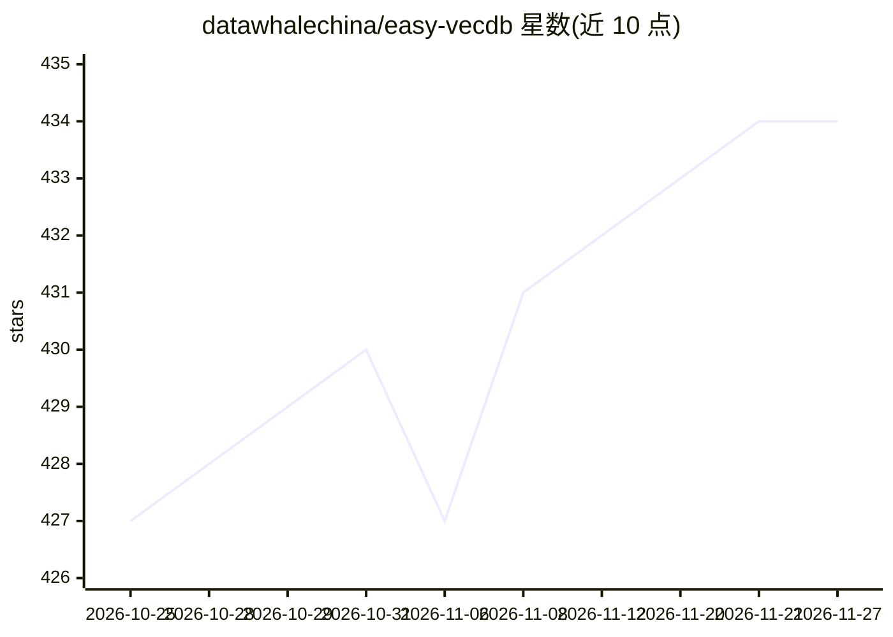

# datawhalechina/easy-vecdb

⭐ 434 · Jupyter Notebook · Apache-2.0 · 推送 2026-11-26 · [GitHub](https://github.com/datawhalechina/easy-vecdb) · [官网](https://datawhalechina.github.io/easy-vecdb/) · 组织维护 · 中文 README

**面向开发者与研究者的向量数据库原理与实践教程**

Datawhale 出品的系统性学习项目，内容分基础学习篇与实践篇两部分：覆盖向量数据库原理、嵌入基础、ANN 搜索算法（IVF、PQ、HNSW、LSH、Annoy、Vamana、DiskANN），以及 Annoy、Faiss、Milvus 三个工具的分章教程，另含推荐召回、RAG、Agent 等实战项目案例。以在线文档形式持续更新，采用 CC BY-NC-SA 4.0 许可协议，贡献流程依托 Datawhale 开源社区规范。

## 筛选速览

| 维度 | 判定 | 备注 |
|---|---|---|
| AI 角色 | `ai-knowledge` | 知识聚合/清单类 |
| 许可风险 | `permissive` | Apache-2.0 |
| 部署形态 | `None` |  |
| 模型依赖 | — | README 未给出锁定关系 |
| 硬件要求 | — | 无带数字的原话,不猜 |
| 安装摩擦 | `low` | 无编译、无系统依赖或容器化 |
| 成熟度 | — | 结构信号不足 |

## 能力要点

- 覆盖 Annoy、Faiss、Milvus 三个向量检索工具的分章教程
- 讲解 IVF、PQ、HNSW、LSH、Vamana、DiskANN 等 ANN 算法原理与代码实战
- 包含 RAG、推荐召回、Agent 等 4 个实战项目
- 在线文档站点持续更新，章节均标注完成状态

## 适用场景

- 系统学习向量数据库的原理、架构与索引机制
- 按教程上手 Milvus / Faiss / Annoy 的使用与调优
- 参考实战项目从零构建 RAG 或嵌入检索应用

## 场景标签

`教程课程` · 领域:学习与行业

## 证据(README 行号)

> L10: 📚 从零开始的向量数据库原理与实践教程
> L14: **EasyVecDB** 是一个面向开发者与研究者的 **向量数据库系统性学习项目**。
> L23: 项目共分为 **基础学习篇** 与 **实践篇** 两个部分，对应导航栏配置如下：

## 星数曲线

2026-10-25 427 → 2026-11-27 434（+7）

---
*卡片 v1 · prompt 1.4 · 生成 2026-11-27 · 置信度 high · 依据 README sha `2b2eb3970523` · [字段定义](../../DATASET.md)*
