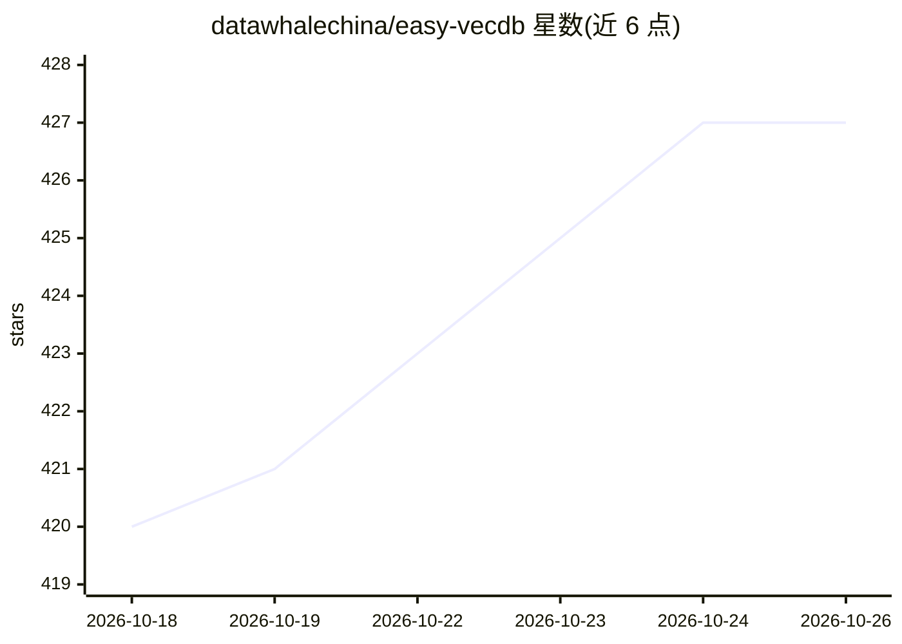

# datawhalechina/easy-vecdb

⭐ 427 · Jupyter Notebook · Apache-2.0 · 推送 2026-08-16 · [GitHub](https://github.com/datawhalechina/easy-vecdb) · [官网](https://datawhalechina.github.io/easy-vecdb/) · 组织维护 · 中文 README

**面向开发者与研究者的向量数据库原理与实践系统教程**

Datawhale 维护的中文开源教程项目，覆盖向量数据库原理、嵌入与搜索算法（IVF/PQ/HNSW/LSH/Annoy）、Annoy/Faiss/Milvus 三个工具的专项教程，以及从零实现向量数据库、RAG、图像检索、推荐召回等实践项目，另含 FusionANNS、RabitQ、Meta-Chunking 等补充专题。内容分基础学习篇与实践篇，以在线文档站点形式提供阅读，配套示例数据与源码目录，采用 CC BY-NC-SA 4.0 许可，持续更新中。

## 筛选速览

| 维度 | 判定 | 备注 |
|---|---|---|
| AI 角色 | `ai-knowledge` | 知识聚合/清单类 |
| 许可风险 | `permissive` | Apache-2.0 |
| 部署形态 | `None` |  |
| 模型依赖 | — | README 未给出锁定关系 |
| 硬件要求 | — | 无带数字的原话,不猜 |
| 安装摩擦 | `low` | 无编译、无系统依赖或容器化 |
| 成熟度 | — | 结构信号不足 |

## 能力要点

- 覆盖 IVF、PQ、HNSW、LSH、Annoy 等 ANN 算法原理与代码实战
- Annoy / Faiss / Milvus 三大工具的分章教程（含 GPU、性能调优、工程化落地）
- 含从零实现向量数据库与多个 RAG / 图像检索 / 推荐召回实战项目
- 提供在线文档站点与中英双语 README

## 适用场景

- 系统学习向量数据库原理与 ANN 索引算法
- 上手 Milvus / Faiss / Annoy 的使用与性能调优
- 参考 RAG、图像检索、推荐召回的完整项目实现

## 场景标签

`教程课程` `向量数据库` `RAG` · 领域:知识与检索

## 证据(README 行号)

> L10: 📚 从零开始的向量数据库原理与实践教程
> L14: **EasyVecDB** 是一个面向开发者与研究者的 **向量数据库系统性学习项目**。
> L15: 项目内容覆盖从基础概念、算法原理到生产级应用部署的全流程，聚焦以下三个方向：

## 星数曲线

2026-10-18 420 → 2026-10-26 427（+7）

---
*卡片 v1 · prompt 1.4 · 生成 2026-10-21 · 置信度 high · 依据 README sha `79b645e9786e` · [字段定义](../../DATASET.md)*
