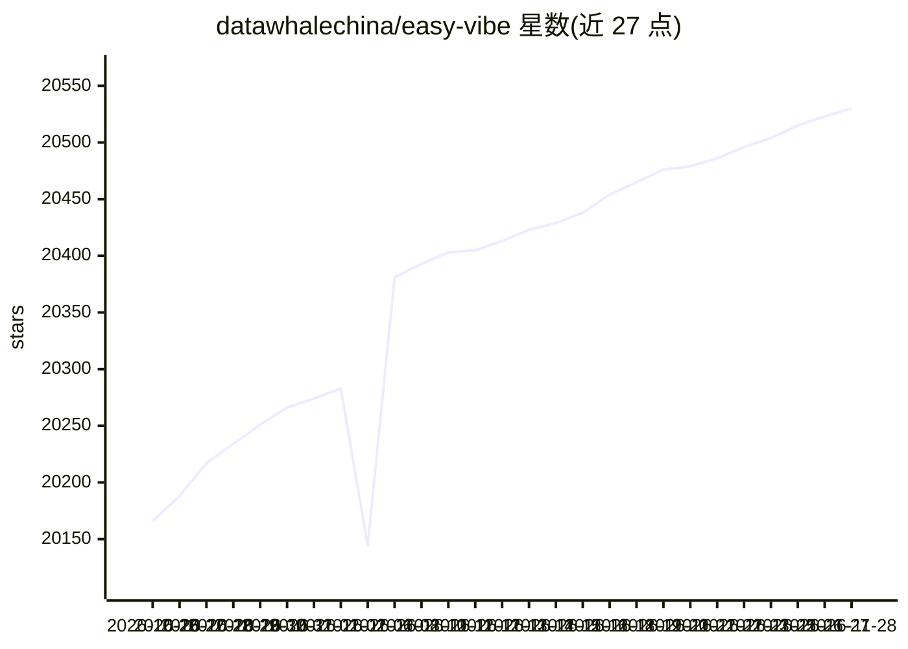

# datawhalechina/easy-vibe

⭐ 20,530 · JavaScript · 推送 2026-11-27 · [GitHub](https://github.com/datawhalechina/easy-vibe) · [官网](https://datawhalechina.github.io/easy-vibe/) · 组织维护 · 中文 README

**零基础到开发者的 Vibe Coding 产品实战教程**

Datawhale 出品的 Vibe Coding 在线教程，按三阶段组织：产品原型（从需求发现到 AI 能力集成）、全栈开发（前端、数据库、后端、部署、计费）、进阶工作流（Claude Code、MCP、Skills、Agent Teams），附 9 大知识领域附录与用户研究方法。提供交互式组件演示 RAG 数据流与 AI 原理，内容覆盖 10 种语言。面向零基础学习者、产品经理、创始人与初中级开发者，README 未提供本地安装步骤，仅有在线阅读入口。

## 筛选速览

| 维度 | 判定 | 备注 |
|---|---|---|
| AI 角色 | `ai-knowledge` | 知识聚合/清单类 |
| 许可风险 | `none` | — |
| 部署形态 | `library` | 以包/库形式分发 |
| 模型依赖 | — | README 未给出锁定关系 |
| 硬件要求 | — | 无带数字的原话,不猜 |
| 安装摩擦 | `low` | 无编译、无系统依赖或容器化 |
| 成熟度 | — | 结构信号不足 |

## 动量与使用信号

- 维护:`active` — 距上次 push 54.3 天,年发版 1,27 位贡献者
- 涨星:近 1 天 **+16**(自 20261016 起算)
- 下载:GitHub Release 附件 累计 1,005(1 个 release)
- 平台:— · 协议:MCP

## 能力要点

- 三阶段学习路线：原型、全栈、Claude Code/Agent 进阶
- 交互式教程组件：RAG 数据流点击演示、AI 原理动画、虚拟鼠标 IDE 引导
- 提供 llms.txt 供 OpenClaw/Claude/Cursor 等 agent 读取仓库结构
- 教程内容覆盖 10 种语言

## 适用场景

- 零基础从想法走到可演示的产品原型
- 产品经理/创始人低成本验证想法并搭建 MVP
- 学习 Claude Code、MCP、Skills 等 agent 开发工作流
- 查阅计算机基础与 AI 原理参考知识库

## 场景标签

`教程课程` · 领域:学习与行业

## 证据(README 行号)

> L3:  A hands-on Vibe Coding guide chosen by tens of thousands of learners.
> L94: ## Table of Contents
> L168: ### AI-Native: I want advanced Claude Code and agent workflows

## 星数曲线

2026-10-26 20,166 → 2026-11-28 20,530（+364）

---
*卡片 v1 · prompt 1.4 · 生成 2026-11-22 · 置信度 mid · 依据 README sha `d2cb8b5b2dd9` · [字段定义](../../DATASET.md)*
