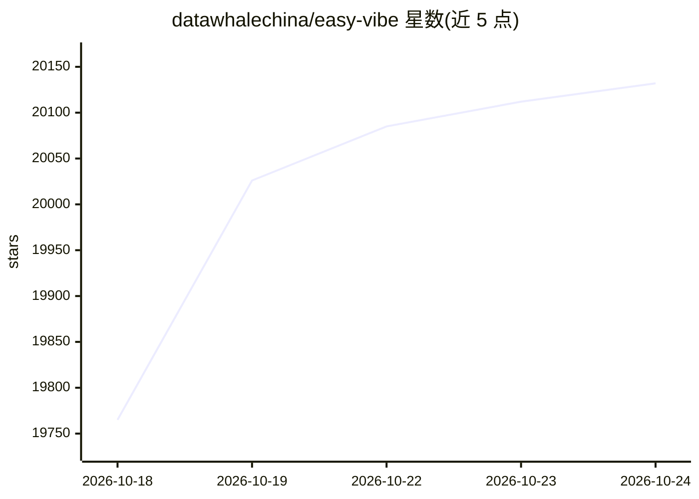

# datawhalechina/easy-vibe

⭐ 20,144 · JavaScript · 推送 2026-10-22 · [GitHub](https://github.com/datawhalechina/easy-vibe) · [官网](https://datawhalechina.github.io/easy-vibe/) · 组织维护 · 中文 README

**面向零基础学习者的 Vibe Coding 产品实战教程**

Datawhale 维护的 AI 编程（Vibe Coding）开源教程：从想法验证、AI 工具上手、产品原型，到全栈开发、部署计费与 Claude Code/MCP/Agent 高级工作流，分阶段提供路线图与讲解，并附 9 大知识领域、80+ 交互主题的附录知识库。教程内容支持 10 种语言，覆盖完全新手、产品经理/创始人、学生与各阶段开发者；提供在线阅读与交互式演示（Prompt 实验、RAG 流程等），学习者可通过 PR 提交自己的作品案例。

## 筛选速览

| 维度 | 判定 | 备注 |
|---|---|---|
| AI 角色 | `ai-knowledge` | 知识聚合/清单类 |
| 许可风险 | `none` | — |
| 部署形态 | `library` | 以包/库形式分发 |
| 模型依赖 | — | README 未给出锁定关系 |
| 硬件要求 | — | 无带数字的原话,不猜 |
| 安装摩擦 | `low` | 无编译、无系统依赖或容器化 |
| 成熟度 | — | 结构信号不足 |

## 动量与使用信号

- 维护:`active` — 距上次 push 54.3 天,年发版 1,27 位贡献者
- 涨星:近 1 天 **+16**(自 20261016 起算)
- 下载:GitHub Release 附件 累计 1,005(1 个 release)
- 平台:— · 协议:MCP

## 能力要点

- 分阶段学习路径：原型→全栈→Claude Code/Agent 高级工作流
- 附录知识库覆盖 9 大领域、80+ 交互主题
- 10 种语言全覆盖的教程内容
- 提供交互式演示（Prompt 实验、RAG 数据流、终端概念可视化）

## 适用场景

- 零基础第一次用 AI 做出自己的产品原型
- 产品经理/创始人低成本验证想法并搭 MVP
- 开发者学习 Claude Code、MCP 与 Agent 工作流
- 遇到概念阻塞时查阅基础知识库

## 场景标签

`教程课程` · 领域:学习与行业

## 证据(README 行号)

> L3:  A hands-on Vibe Coding guide chosen by tens of thousands of learners.
> L82: ## Table of Contents
> L133: ## Your Learning Paths

## 星数曲线

2026-10-18 19,765 → 2026-10-24 20,132（+367）

---
*卡片 v1 · prompt 1.4 · 生成 2026-10-20 · 置信度 mid · 依据 README sha `604ad1f5bb26` · [字段定义](../../DATASET.md)*
