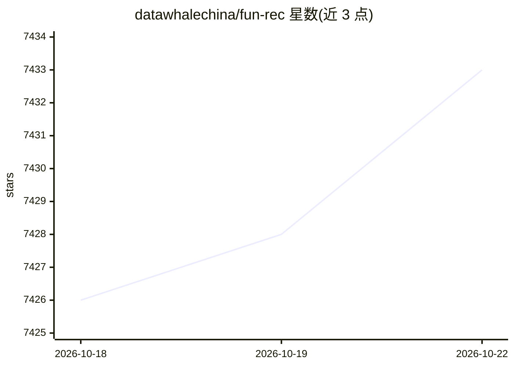

# datawhalechina/fun-rec

⭐ 7,435 · Python · 推送 2026-06-27 · [GitHub](https://github.com/datawhalechina/fun-rec) · 组织维护 · 中文 README

**推荐系统中文教程：从级联架构到生成式范式**

Datawhale 维护的深度推荐算法实践教程（小麦书），系统介绍推荐系统从传统级联架构到生成式范式的技术演进。上篇覆盖协同过滤、向量/序列召回、特征交叉、多目标与多场景精排、重排多样性；下篇聚焦生成式推荐，涵盖 LLM 建模、Tokenizer、Scaling Law 架构、端到端生成式建模、推理与扩散模型推荐，并附生产级系统实战项目。提供在线阅读地址，配微信群/知识星球学习社区。项目声明仍在开发中、暂不接受 Pull Request。适合具备机器学习基础的读者。

## 筛选速览

| 维度 | 判定 | 备注 |
|---|---|---|
| AI 角色 | `ai-knowledge` | 知识聚合/清单类 |
| 许可风险 | `none` | — |
| 部署形态 | `None` |  |
| 模型依赖 | — | README 未给出锁定关系 |
| 硬件要求 | — | 无带数字的原话,不猜 |
| 安装摩擦 | `low` | 无编译、无系统依赖或容器化 |
| 成熟度 | `idea` | |

## 能力要点

- 上篇覆盖召回、精排、重排的级联架构方法
- 下篇涵盖生成式推荐、Scaling Law、扩散模型等前沿范式
- 附生产级推荐系统构建实战项目
- 提供在线阅读地址与学习社区

## 适用场景

- 系统学习推荐系统从传统到生成式的完整技术脉络
- 准备推荐算法方向的面试与竞赛
- 参考生产级推荐系统的架构与部署实践

## 场景标签

`推荐系统` `教程课程` · 领域:学习与行业

## 证据(README 行号)

> L9: 本书系统介绍了推荐系统从传统级联架构到生成式范式的完整技术演进。内容分为两大板块：上篇覆盖协同过滤、向量召回、序列召回等候选检索技术，以及特征交叉、多目标建模、多场景建模等精排与重排方法；下篇聚焦前沿生成式推荐，涵盖大模型基础、Sc
> L53: - **10. 生产级推荐系统构建**

## 星数曲线

2026-10-18 7,426 → 2026-10-22 7,433（+7）

---
*卡片 v1 · prompt 1.4 · 生成 2026-10-20 · 置信度 high · 依据 README sha `086be5d230f8` · [字段定义](../../DATASET.md)*
