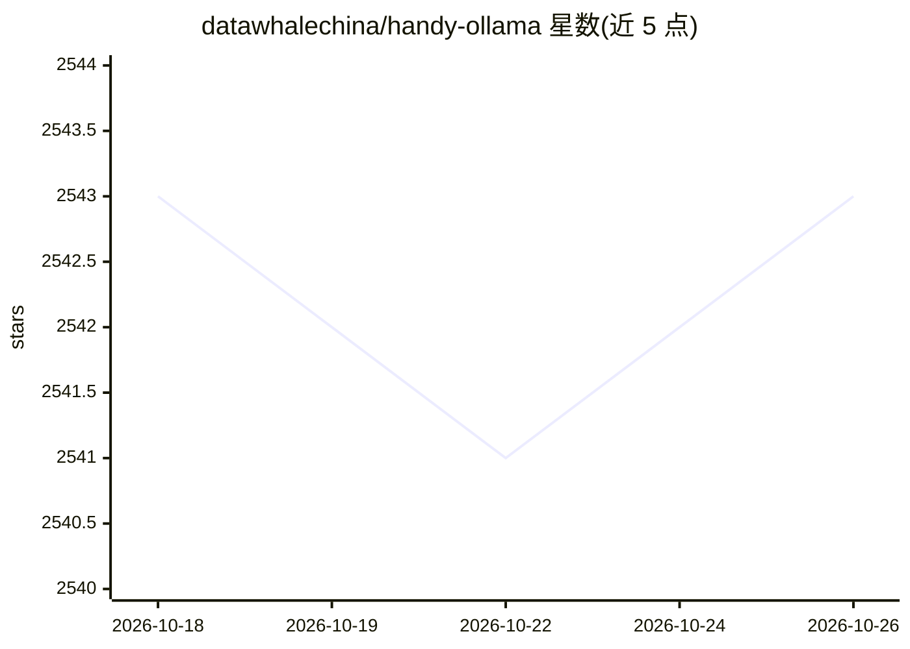

# datawhalechina/handy-ollama

⭐ 2,543 · Jupyter Notebook · NOASSERTION · 推送 2026-01-15 · [GitHub](https://github.com/datawhalechina/handy-ollama) · [官网](https://datawhalechina.github.io/handy-ollama/) · 组织维护 · 中文 README

**动手学 Ollama 教程：CPU 部署本地大模型的中文开源教程**

Datawhale 维护的中文开源教程，教授用 Ollama 在 CPU 环境下本地部署和运行大模型。内容覆盖 Ollama 在 macOS/Windows/Linux/Docker 的安装配置、从 GGUF/Pytorch/Safetensors 导入自定义模型、REST API 在 Python/Java/JavaScript/C++/Golang 等语言中的调用、LangChain 集成，以及 FastAPI/WebUI 可视化界面与本地 RAG、Agent 等应用案例。教程主体已完成，处于 Beta 公测阶段，部分语言章节待更新。提供在线阅读地址。

## 筛选速览

| 维度 | 判定 | 备注 |
|---|---|---|
| AI 角色 | `ai-knowledge` | 知识聚合/清单类 |
| 许可风险 | `none` | NOASSERTION |
| 部署形态 | `None` |  |
| 模型依赖 | — | README 未给出锁定关系 |
| 硬件要求 | — | 无带数字的原话,不猜 |
| 安装摩擦 | `low` | 无编译、无系统依赖或容器化 |
| 成熟度 | `idea` | |

## 能力要点

- 覆盖安装配置、自定义模型导入、REST API、LangChain 集成到应用案例的完整路径
- 以 CPU 部署本地大模型为主线，面向资源受限的学习者
- 含 FastAPI/WebUI 可视化界面与本地 RAG、Agent 应用案例
- 2025.11 被 Ollama 官方仓库收录为 Tutorial

## 适用场景

- 在没有 GPU 的个人 PC 上学习大模型本地部署
- 学习通过 REST API 和多种编程语言调用 Ollama
- 参考教程搭建本地 RAG、Agent 与可视化对话应用

## 场景标签

`教程课程` · 领域:学习与行业

## 证据(README 行号)

> L23: 动手学 Ollama 教程，轻松上手实现大模型本地化部署，快速在本地管理以及运行大模型，让 CPU 也可以玩转大模型推理部署！
> L25: 本教程涵盖从基础入门到进阶使用的全方位内容，并通过实际应用案例深入理解和掌握大模型部署以及应用技术。我们的教程提供清晰的步骤和实用的技巧，无论是刚刚接触大模型部署的小白，还是有一定经验的开发者，都可以从零开始学习 Ollama ，

## 星数曲线

2026-10-18 2,543 → 2026-10-26 2,543（+0）

---
*卡片 v1 · prompt 1.4 · 生成 2026-10-21 · 置信度 high · 依据 README sha `491bb5fdfbfa` · [字段定义](../../DATASET.md)*
