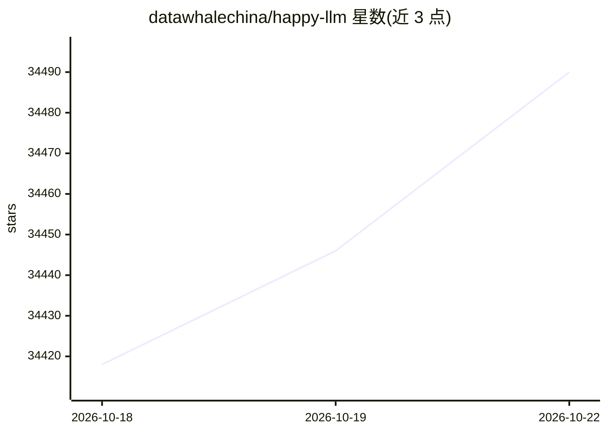

# datawhalechina/happy-llm

⭐ 34,490 · Jupyter Notebook · NOASSERTION · 推送 2026-08-08 · [GitHub](https://github.com/datawhalechina/happy-llm) · [官网](https://datawhalechina.github.io/happy-llm/) · 组织维护 · 中文 README

**面向 LLM 学习者的大模型原理与训练系统教程**

Datawhale 出品的系统性 LLM 学习教程，从 NLP 基础、Transformer 架构、预训练语言模型讲起，到基于 PyTorch 亲手实现 LLaMA2、训练 Tokenizer 并完成预训练、SFT 与 LoRA/QLoRA 微调，再延伸至 RAG、Agent 与 GRPO 等 Agentic RL 内容。提供在线阅读、PDF 与 PPT 资源，第5/6章训练代码按章节拆分依赖，需具备 Python 与深度学习基础。

## 筛选速览

| 维度 | 判定 | 备注 |
|---|---|---|
| AI 角色 | `ai-knowledge` | 知识聚合/清单类 |
| 许可风险 | `none` | NOASSERTION |
| 部署形态 | `None` |  |
| 模型依赖 | — | README 未给出锁定关系 |
| 硬件要求 | — | 无带数字的原话,不猜 |
| 安装摩擦 | `low` | 无编译、无系统依赖或容器化 |
| 成熟度 | — | 结构信号不足 |

## 动量与使用信号

- 维护:`active` — 距上次 push 70.6 天,年发版 1,27 位贡献者
- 涨星:近 1 天 **+20**(自 20261016 起算)
- 下载:GitHub Release 附件 累计 32,055(3 个 release)

## 能力要点

- 8 章覆盖从 NLP 基础到 Agentic-RL（GRPO、Search-R1、ReTool）的完整学习路径
- 动手实现 LLaMA2 并完成预训练、SFT、LoRA/QLoRA 微调全流程
- 提供教程 PDF 与配套 PPT 下载，附 ModelScope 模型与创空间体验
- Extra Chapter 开放社区 Blog 投稿（PR 贡献机制）

## 适用场景

- 系统学习 Transformer 与大语言模型原理
- 按教程用 PyTorch 与 Transformers 框架动手训练小型 LLM
- 了解 RAG、Agent 与 Agentic RL 的入门实践

## 场景标签

`教程课程` · 领域:学习与行业

## 证据(README 行号)

> L22: &emsp;&emsp;本项目是一个**系统性的 LLM 学习教程**，将从 NLP 的基本研究方法出发，根据 LLM 的思路及原理逐层深入，依次为读者剖析 LLM 的架构基础和训练过程。同时，我们会结合目前 LLM 领域最主流的
> L97: &emsp;&emsp;本项目分为两部分——基础知识与实战应用。第1章～第4章是基础知识部分，从浅入深介绍 LLM 的基本原理。其中，第1章简单介绍 NLP 的基本任务和发展，为非 NLP 领域研究者提供参考；第2章介绍 LLM 
> L145: 本作品采用知识共享署名-非商业性使用-相同方式共享 4.0 国际许可协议进行许可。

## 星数曲线

2026-10-18 34,418 → 2026-10-22 34,490（+72）

---
*卡片 v1 · prompt 1.4 · 生成 2026-10-18 · 置信度 high · 依据 README sha `621d075c935f` · [字段定义](../../DATASET.md)*
