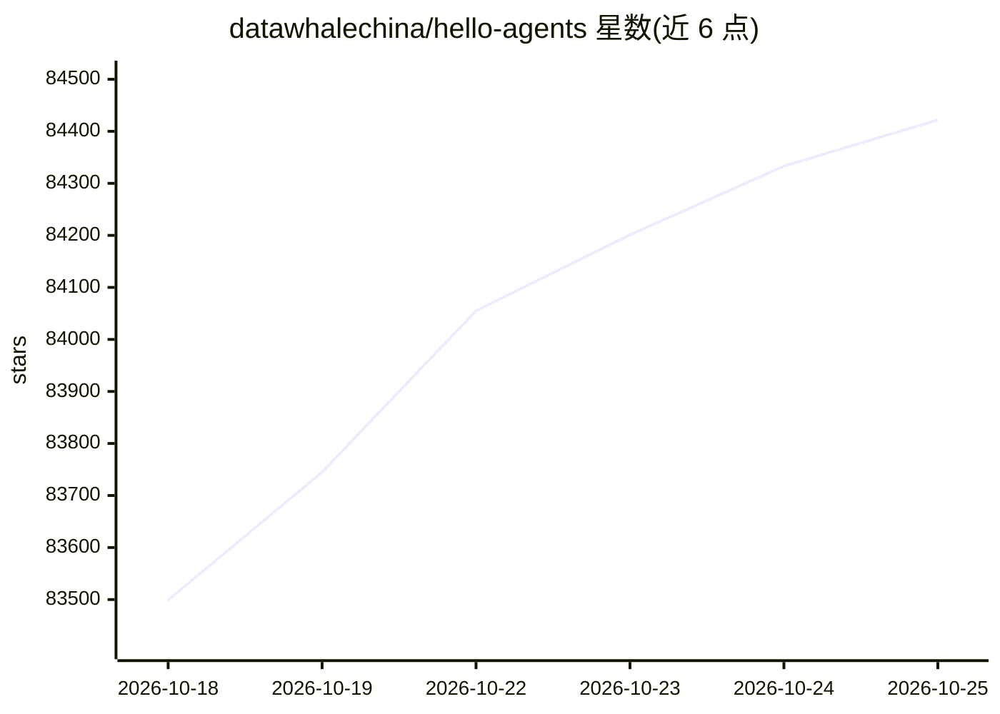

# datawhalechina/hello-agents

⭐ 84,422 · Python · NOASSERTION · 推送 2026-10-13 · [GitHub](https://github.com/datawhalechina/hello-agents) · [官网](https://hello-agents.datawhale.cc) · 组织维护 · 中文 README

**面向开发者的从零构建智能体系统开源教程**

Datawhale 社区出品的系统性智能体学习教程，共 16 章，覆盖智能体基础、经典范式（ReAct、Plan-and-Solve、Reflection）、低代码平台使用、主流框架应用、自研框架 HelloAgents 构建、RAG 与记忆、上下文工程、MCP 等通信协议、Agentic RL 训练与性能评估，并附智能旅行助手、DeepResearch 复现、赛博小镇等实战案例。提供在线阅读、PDF 下载与配套代码。要求读者具备基础 Python 能力与 LLM 概念性了解，采用 CC BY-NC-SA 4.0 协议。

## 筛选速览

| 维度 | 判定 | 备注 |
|---|---|---|
| AI 角色 | `ai-native` | 本体是模型或模型工具 |
| 许可风险 | `none` | NOASSERTION |
| 部署形态 | `None` |  |
| 模型依赖 | — | README 未给出锁定关系 |
| 硬件要求 | — | 无带数字的原话,不猜 |
| 安装摩擦 | `low` | 无编译、无系统依赖或容器化 |
| 成熟度 | — | 结构信号不足 |

## 动量与使用信号

- 维护:`active` — 距上次 push 4.4 天,年发版 3,108 位贡献者
- 涨星:近 1 天 **+113**(自 20261016 起算)
- 下载:GitHub Release 附件 累计 35,682(3 个 release)
- 平台:— · 协议:MCP

## 能力要点

- 16 章教程覆盖从 LLM 基础到多智能体应用的全流程
- 基于 OpenAI 原生 API 从零构建自研框架 HelloAgents
- 提供配套代码仓库与社区贡献章节（面试题、踩坑经验等）
- 提供在线阅读、国内加速访问与 PDF 下载渠道

## 适用场景

- 系统学习智能体原理与经典范式并动手实现
- 了解 Dify、Coze 等低代码平台与 LangGraph 等框架的使用
- 跟随实战章节开发旅行助手、深度研究智能体等多智能体项目
- 准备 Agent 岗位求职面试

## 场景标签

`教程课程` · 领域:学习与行业

## 证据(README 行号)

> L22: &emsp;&emsp;Hello-Agents 是 Datawhale 社区的 系统性智能体学习教程 。如今 Agent 构建主要分为两派，一派是 Dify，Coze，n8n 这类软件工程类 Agent，其本质是流程驱动的软件开
> L37: - 🛠️ 自研框架 HelloAgents 基于 Openai 原生 API 从零构建一个自己的智能体框架
> L103: &emsp;&emsp;本项目内容兼顾理论与实战，旨在帮助你系统性地掌握从单个智能体到多智能体系统的设计与开发全流程。因此，尤其适合有一定编程基础的 AI 开发者、软件工程师、在校学生 以及对前沿 AI 技术抱有浓厚兴趣的 自学

## 星数曲线

2026-10-18 83,499 → 2026-10-25 84,422（+923）

---
*卡片 v1 · prompt 1.4 · 生成 2026-10-18 · 置信度 high · 依据 README sha `589877fccf3d` · [字段定义](../../DATASET.md)*
