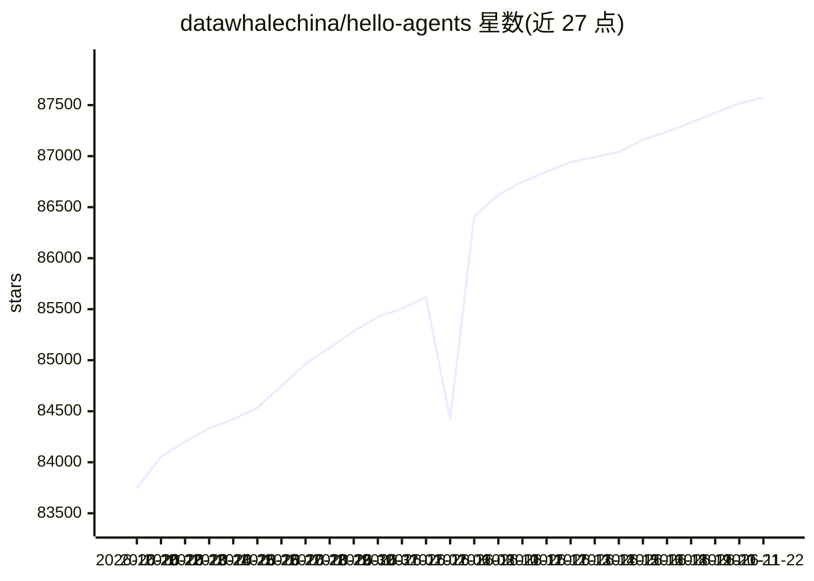

# datawhalechina/hello-agents

⭐ 87,574 · Python · NOASSERTION · 推送 2026-11-13 · [GitHub](https://github.com/datawhalechina/hello-agents) · [官网](https://hello-agents.datawhale.cc) · 组织维护 · 中文 README

**Datawhale 出品的智能体原理与实战开源教程**

Datawhale 社区发布的系统性智能体学习教程，共 16 章，覆盖智能体基础理论、经典范式（ReAct、Plan-and-Solve、Reflection）实现、低代码平台与代码框架使用、自研框架 HelloAgents 构建、记忆与检索、上下文工程、通信协议、Agentic RL 训练与评估，并配套智能旅行助手、深度研究智能体、赛博小镇等综合案例。面向有 Python 基础的 AI 开发者、软件工程师、在校学生与自学者，提供在线阅读、PDF 下载、配套代码与社区贡献章节。采用 CC BY-NC-SA 4.0 许可。

## 筛选速览

| 维度 | 判定 | 备注 |
|---|---|---|
| AI 角色 | `ai-knowledge` | 知识聚合/清单类 |
| 许可风险 | `none` | NOASSERTION |
| 部署形态 | `None` |  |
| 模型依赖 | — | README 未给出锁定关系 |
| 硬件要求 | — | 无带数字的原话,不猜 |
| 安装摩擦 | `low` | 无编译、无系统依赖或容器化 |
| 成熟度 | — | 结构信号不足 |

## 动量与使用信号

- 维护:`active` — 距上次 push 4.4 天,年发版 3,108 位贡献者
- 涨星:近 1 天 **+113**(自 20261016 起算)
- 下载:GitHub Release 附件 累计 35,682(3 个 release)
- 平台:— · 协议:MCP

## 能力要点

- 16 章教程覆盖从 LLM 基础到多智能体应用的全流程
- 基于 OpenAI 原生 API 从零构建自研框架 HelloAgents（V1.0.0）
- 配套 code 文件夹提供全部可运行代码
- 社区贡献 14 篇 Extra-Chapter 与视频课程

## 适用场景

- 系统学习智能体原理与经典范式实现
- 按章节实战开发多智能体应用
- 准备 Agent 相关岗位面试

## 场景标签

`教程课程` · 领域:学习与行业

## 证据(README 行号)

> L20: &emsp;&emsp;如果说 2024 年是"百模大战"的元年，那么 2025 年无疑开启了"Agent 元年"。技术的焦点正从训练更大的基础模型，转向构建更聪明的智能体应用。然而，当前系统性、重实践的教程却极度匮乏。为此，我们
> L22: &emsp;&emsp;Hello-Agents 是 Datawhale 社区的 系统性智能体学习教程 。如今 Agent 构建主要分为两派，一派是 Dify，Coze，n8n 这类软件工程类 Agent，其本质是流程驱动的软件开
> L45: |章节|关键内容|状态|

## 星数曲线

2026-10-20 83,745 → 2026-11-22 87,574（+3,829）

---
*卡片 v1 · prompt 1.4 · 生成 2026-11-22 · 置信度 high · 依据 README sha `511e60d5d588` · [字段定义](../../DATASET.md)*
