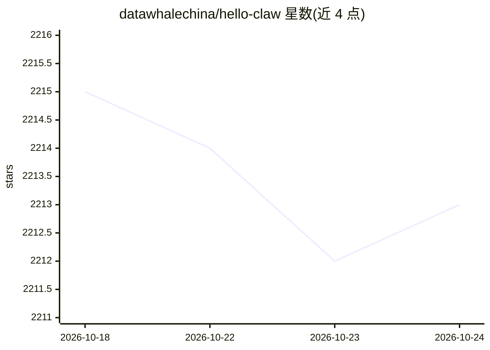

# datawhalechina/hello-claw

⭐ 2,213 · Python · 推送 2026-10-12 · [GitHub](https://github.com/datawhalechina/hello-claw) · [官网](https://datawhalechina.github.io/hello-claw) · 组织维护 · 中文 README

**OpenClaw 命令行 AI 助理的中文系统教程（领养/大学/构建）**

Datawhale 维护的面向 OpenClaw 命令行 AI 助理系统的学习教程，分三大模块：领养龙虾（使用篇，11 章+7 附录，覆盖 AutoClaw 一键安装、手动安装、聊天平台接入、模型与智能体管理、网关运维与安全防护）；龙虾大学（场景实战篇，含个人效率、编程开发、内容创作、商务销售、多智能体协作等 11 篇案例）；构建龙虾（开发篇 13 章，拆解 OpenClaw 源码架构、轻量化/安全加固/硬件定制方案与 Skill 编写）。面向零基础用户、效率达人、技术爱好者与开发者。采用 CC BY-NC-SA 4.0 许可，提供在线阅读站点。

## 筛选速览

| 维度 | 判定 | 备注 |
|---|---|---|
| AI 角色 | `ai-knowledge` | 知识聚合/清单类 |
| 许可风险 | `none` | — |
| 部署形态 | `library` | 以包/库形式分发 |
| 模型依赖 | — | README 未给出锁定关系 |
| 硬件要求 | — | 无带数字的原话,不猜 |
| 安装摩擦 | `low` | 无编译、无系统依赖或容器化 |
| 成熟度 | — | 结构信号不足 |

## 能力要点

- 使用篇 11 章+附录覆盖安装、配置、运维、安全全流程
- 11 篇场景实战案例（个人效率/编程/内容创作/多智能体协作等）
- 开发篇 13 章拆解 OpenClaw 架构（ReAct 循环、提示词系统、工具系统、安全沙箱）
- 附录含类 Claw 方案对比、模型提供商选型指南与命令速查表

## 适用场景

- 零基础安装并配置 OpenClaw 作为个人 AI 助理
- 按场景挑选 Skills 快速落地自动化工作流
- 学习 Agent 架构原理并构建定制版本

## 场景标签

`教程课程` · 领域:学习与行业

## 证据(README 行号)

> L28: 本项目是一个面向 OpenClaw 的完整学习教程，帮助你从零开始掌握这个强大的命令行 AI 助理系统。无论你是想快速上手使用 OpenClaw 提升效率，还是想深入理解其原理并构建自己的版本，本教程都能为你提供清晰的学习路径。
> L32: 1. **领养龙虾（使用篇）**：11 章 + 7 个附录，安装（Ch1-3）+ 核心配置（Ch4-6）+ 扩展运维（Ch7-9）+ 安全与客户端（Ch10-11），按需选读
> L33: 2. **龙虾大学（场景实战篇）**：围绕 Skills 选型与典型工作流，给出可直接复用的实战案例
> L34: 3. **构建龙虾（开发篇）**：11 章，先拆解 OpenClaw 源码与替代方案，再进入 Skills、渠道和完整定制

## 星数曲线

2026-10-18 2,215 → 2026-10-24 2,213（-2）

---
*卡片 v1 · prompt 1.4 · 生成 2026-10-21 · 置信度 mid · 依据 README sha `cb7a91174176` · [字段定义](../../DATASET.md)*
