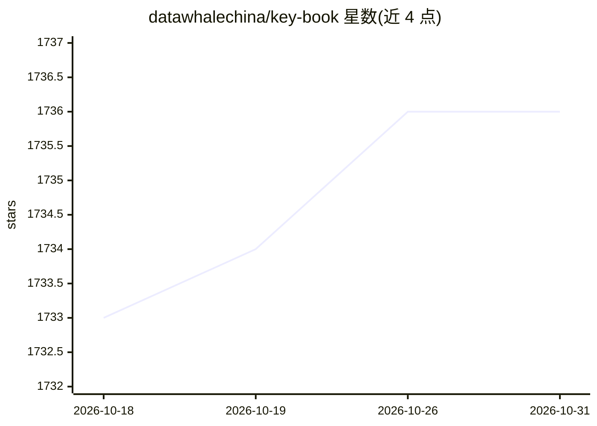

# datawhalechina/key-book

⭐ 1,736 · Jupyter Notebook · NOASSERTION · 推送 2026-09-09 · [GitHub](https://github.com/datawhalechina/key-book) · [官网](https://datawhalechina.github.io/key-book/) · 组织维护 · 中文 README

**《机器学习理论导引》伴读笔记：概念、证明与案例补充**

Datawhale 组织编写的开源伴读笔记，针对周志华等著《机器学习理论导引》理论性强、证明精炼、对数学背景要求高的特点，提供三方面补充：解释书中涉及但未阐释的概念、补充证明中被省略的推导步骤、增加实例辅助理解抽象理论。内容覆盖可学性、复杂度、泛化界、稳定性、一致性、收敛率、遗憾界等章节。面向研读该书的读者、机器学习理论入门的研究者与学生，以及想补充理论基础的工程师。提供在线阅读与 PDF 下载，采用 CC BY-NC-SA 4.0 协议。

## 筛选速览

| 维度 | 判定 | 备注 |
|---|---|---|
| AI 角色 | `ai-knowledge` | 知识聚合/清单类 |
| 许可风险 | `none` | NOASSERTION |
| 部署形态 | `None` |  |
| 模型依赖 | — | README 未给出锁定关系 |
| 硬件要求 | — | 无带数字的原话,不猜 |
| 安装摩擦 | `low` | 无编译、无系统依赖或容器化 |
| 成熟度 | — | 结构信号不足 |

## 能力要点

- 概念解释、证明补充、案例分享三方面伴读内容
- 覆盖《导引》七个核心理论主题（可学性至遗憾界）
- 提供在线阅读与 PDF 下载
- 由 Datawhale 编委会组织编写，接受 Issue/PR 贡献

## 适用场景

- 研读《机器学习理论导引》时查阅概念与证明细节
- 系统入门机器学习理论（PAC、VC 维、泛化界等）
- 有实践经验的工程师补充理论基础
- 与南瓜书（西瓜书伴读）搭配学习

## 场景标签

`教程课程` · 领域:学习与行业

## 证据(README 行号)

> L5:  《机器学习理论导引》伴读笔记：概念解释 · 证明补充 · 案例分享
> L18: 周志华、王魏、高尉、张利军等老师所著的《机器学习理论导引》（下称《导引》），填补了国内缺少机器学习理论入门著作的遗憾。该书涵盖机器学习理论中七个核心概念：**可学性、复杂度、泛化界、稳定性、一致性、收敛率、遗憾界**。
> L20: 然而，《导引》理论性强、证明精炼，对读者数学背景要求较高。我们编写《钥匙书》这份伴读笔记，旨在帮助读者更快走出迷雾。

## 星数曲线

2026-10-18 1,733 → 2026-10-31 1,736（+3）

---
*卡片 v1 · prompt 1.4 · 生成 2026-10-21 · 置信度 high · 依据 README sha `e5ad35d93b31` · [字段定义](../../DATASET.md)*
