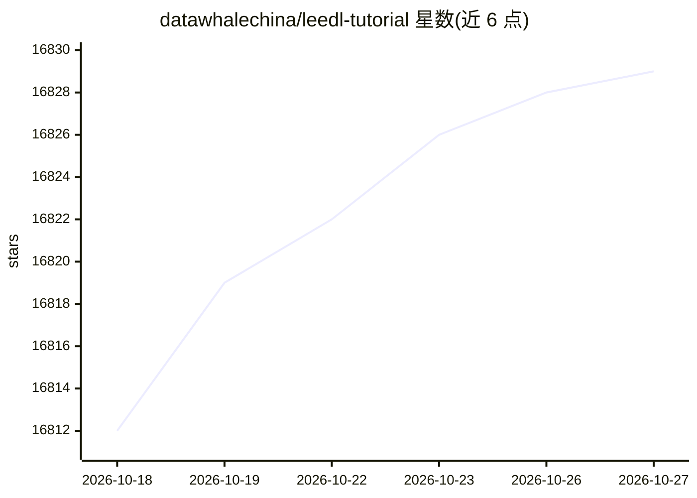

# datawhalechina/leedl-tutorial

⭐ 16,829 · Jupyter Notebook · NOASSERTION · 推送 2026-10-23 · [GitHub](https://github.com/datawhalechina/leedl-tutorial) · 组织维护 · 中文 README

**面向中文读者的李宏毅深度学习课程整理教程（PDF 书籍）**

Datawhale 组织维护的开源中文教程，内容整理自李宏毅《机器学习》（2021 年春）课程并补充推导与扩展章节，覆盖深度学习基础、CNN/RNN/Transformer、GAN、BERT/GPT-3、扩散模型、强化学习、网络压缩、元学习与 ChatGPT 原理等主题，每章由不同贡献者署名编写。提供 Releases 页 PDF 下载与百度网盘国内地址，纸质版由人民邮电出版社出版，附勘误表页面和 Homework 文件夹配套代码。采用 CC BY-NC-SA 4.0 许可。

## 筛选速览

| 维度 | 判定 | 备注 |
|---|---|---|
| AI 角色 | `ai-knowledge` | 知识聚合/清单类 |
| 许可风险 | `none` | NOASSERTION |
| 部署形态 | `None` |  |
| 模型依赖 | — | README 未给出锁定关系 |
| 硬件要求 | — | 无带数字的原话,不猜 |
| 安装摩擦 | `low` | 无编译、无系统依赖或容器化 |
| 成熟度 | — | 结构信号不足 |

## 动量与使用信号

- 维护:`declining` — 距上次 push 329.0 天,年发版 0,11 位贡献者
- 涨星:近 1 天 **+2**(自 20261016 起算)
- 下载:GitHub Release 附件 累计 77,271(21 个 release)

## 能力要点

- PDF 全书经 Releases 与百度网盘提供下载
- 章节覆盖 GAN、BERT、扩散模型、强化学习、元学习、ChatGPT 等 17 个主题
- 提供 Homework 文件夹配套代码与在线勘误表
- 纸质版由人民邮电出版社出版，中英双 BibTeX 引用条目

## 适用场景

- 想通过中文讲解入门深度学习理论
- 配合李宏毅公开课视频阅读公式推导
- 查阅 GAN、扩散模型、ChatGPT 原理等专题的学习材料

## 场景标签

`教程课程` · 领域:学习与行业

## 证据(README 行号)

> L3: # 李宏毅深度学习教程LeeDL-Tutorial（苹果书）
> L43: * **引言** @王琦
> L94: ## 配套代码
> L133: 知识共享许可协议 本作品采用知识共享署名-非商业性使用-相同方式共享 4.0 国际许可协议进行许可。

## 星数曲线

2026-10-18 16,812 → 2026-10-27 16,829（+17）

---
*卡片 v1 · prompt 1.4 · 生成 2026-10-18 · 置信度 high · 依据 README sha `dfdaccda263a` · [字段定义](../../DATASET.md)*
