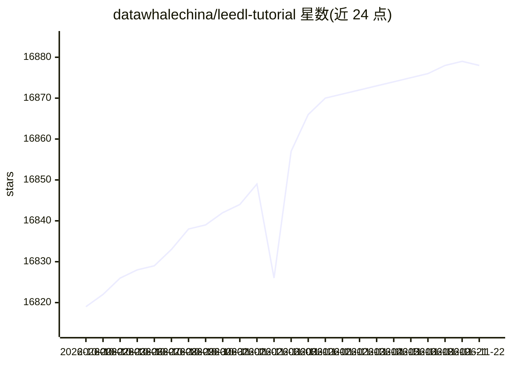

# datawhalechina/leedl-tutorial

⭐ 16,878 · Jupyter Notebook · NOASSERTION · 推送 2026-10-23 · [GitHub](https://github.com/datawhalechina/leedl-tutorial) · 组织维护 · 中文 README

**中文深度学习入门教程：基于李宏毅课程的 PDF 电子书**

Datawhale 开源学习社区整理的中文深度学习教程，内容源于李宏毅《机器学习》（2021年春）公开课，补充公式推导、2017 年春部分内容及其他深度学习知识。章节覆盖反向传播基础、CNN/RNN/Transformer、GAN、BERT/GPT-3、扩散模型、对抗攻击、可解释 AI、迁移学习、强化学习、网络压缩、元学习与 ChatGPT 原理。提供 releases 页 PDF 下载、国内百度网盘地址与纸质版购买渠道，Homework 文件夹附配套代码，采用 CC BY-NC-SA 4.0 许可。

## 筛选速览

| 维度 | 判定 | 备注 |
|---|---|---|
| AI 角色 | `ai-knowledge` | 知识聚合/清单类 |
| 许可风险 | `none` | NOASSERTION |
| 部署形态 | `None` |  |
| 模型依赖 | — | README 未给出锁定关系 |
| 硬件要求 | — | 无带数字的原话,不猜 |
| 安装摩擦 | `low` | 无编译、无系统依赖或容器化 |
| 成熟度 | — | 结构信号不足 |

## 动量与使用信号

- 维护:`declining` — 距上次 push 329.0 天,年发版 0,11 位贡献者
- 涨星:近 1 天 **+2**(自 20261016 起算)
- 下载:GitHub Release 附件 累计 77,271(21 个 release)

## 能力要点

- 内容基于李宏毅 2021 春机器学习课程并含原创推导与补充
- 章节覆盖 CNN、Transformer、GAN、扩散模型、强化学习、元学习等
- 提供 releases PDF 下载、百度网盘国内地址与纸质版购买链接
- Homework 文件夹提供配套代码

## 适用场景

- 想入门深度学习并需要中文讲解的读者
- 按章节系统学习从基础到 GAN、扩散模型、元学习等主题
- 下载 PDF 或购买纸质书作为学习教材
- 获取李宏毅课程的配套作业代码

## 场景标签

`教程课程` · 领域:学习与行业

## 证据(README 行号)

> L3: # 李宏毅深度学习教程LeeDL-Tutorial（苹果书）
> L41: ## 内容介绍
> L92:  * [x] ChatGPT带来的研究问题

## 星数曲线

2026-10-20 16,819 → 2026-11-22 16,878（+59）

---
*卡片 v1 · prompt 1.4 · 生成 2026-11-22 · 置信度 high · 依据 README sha `acc84780a4a5` · [字段定义](../../DATASET.md)*
