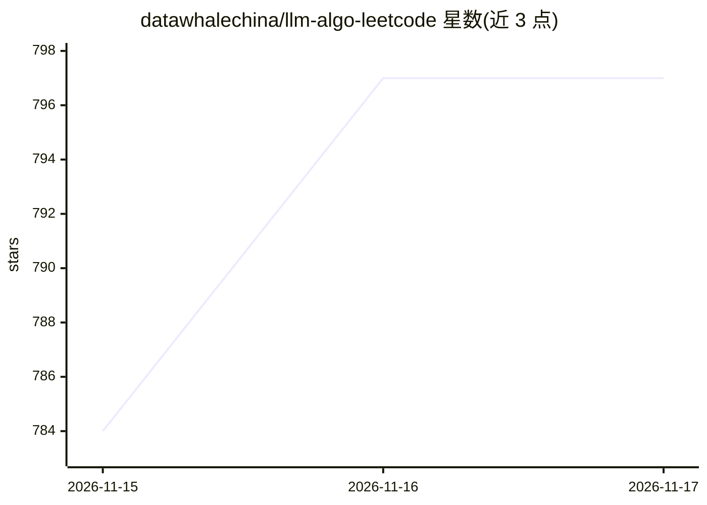

# datawhalechina/llm-algo-leetcode

⭐ 797 · Jupyter Notebook · NOASSERTION · 推送 2026-11-16 · [GitHub](https://github.com/datawhalechina/llm-algo-leetcode) · [官网](https://datawhalechina.github.io/llm-algo-leetcode/) · 组织维护 · 中文 README

**面向学习者的 LLM 算法与系统 Notebook 教程（PyTorch→Triton→CUDA）**

Datawhale 维护的以 Notebook 为载体的大模型算法与系统教程：从 Part 02 的 PyTorch 算法实践出发，按需回补 Python/PyTorch 与硬件数学基础（Part 00/01），延伸到 Triton 算子开发（Part 03）与 CUDA C++ 及系统优化（Part 04），并以综合项目收口。内容按模型架构与训练、后训练、推理优化、性能优化、算子优化五条主路线及基础、横向、领域专题组织，每节含可运行代码、题目区、答案区与验证。第四、五部分及多条专题路线标注为建设中。文字内容 CC BY 4.0、代码 Apache-2.0 分别授权。

## 筛选速览

| 维度 | 判定 | 备注 |
|---|---|---|
| AI 角色 | `ai-knowledge` | 知识聚合/清单类 |
| 许可风险 | `none` | NOASSERTION |
| 部署形态 | `None` |  |
| 模型依赖 | — | README 未给出锁定关系 |
| 硬件要求 | — | 无带数字的原话,不猜 |
| 安装摩擦 | `medium` | 含编译或系统依赖之一 |
| 成熟度 | — | 结构信号不足 |

## 能力要点

- PyTorch → Triton → CUDA 逐层下探的学习路线，覆盖训练、推理、量化、并行与算子优化
- Notebook-first：每节含可运行代码、题目、答案与基础验证
- 通过 benchmark、profiling、真实 GPU 与 inference backend 实验比较吞吐、延迟、显存与成本
- Part 00–04 合计 100+ 节课程，配五条主路线与跨 Part 专题导航

## 适用场景

- 系统学习 Transformer 训练、微调、推理与模型压缩的实现
- 从 PyTorch 进阶到 Triton 算子与 CUDA kernel 开发
- 通过 benchmark 与 profiling 实验建立性能优化判断
- 按专题（量化压缩、通信并行、部署异构等）跳读补齐特定知识

## 场景标签

`教程课程` · 领域:学习与行业

## 证据(README 行号)

> L27: 这是一个以 Notebook 为载体的大模型算法与系统教程。教程从 Part 02 的 PyTorch 算法实践出发，按需回补 Part 00 / Part 01 的基础，并进一步延伸到 Part 03 的 Triton 算子开发
> L3:  Runnable notebooks for LLM algorithms and systems.

## 星数曲线

2026-11-15 784 → 2026-11-17 797（+13）

---
*卡片 v1 · prompt 1.4 · 生成 2026-11-17 · 置信度 high · 依据 README sha `7ce680aaef27` · [字段定义](../../DATASET.md)*
